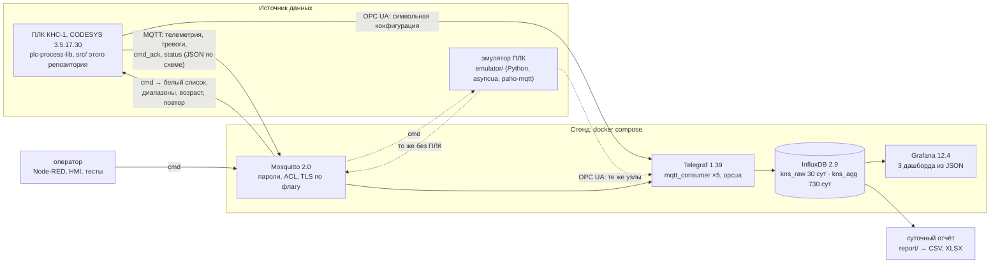

# plc-iiot-stack — от датчика до дашборда

[](https://github.com/<GITHUB_USER>/plc-iiot-stack/actions/workflows/ci.yml)

Воспроизводимый IIoT-стенд для канализационной насосной станции КНС-1 (флагман портфолио): данные ПЛК
на CODESYS по MQTT и OPC UA попадают в InfluxDB 2 и на дашборды Grafana, а команды оператора идут
обратно и проверяются в ПЛК по белому списку. Инфраструктура описана кодом (docker compose), стенд
работает и без ПЛК — на эмуляторе с теми же тегами, что у флагмана. Сторона ПЛК — код ST для CODESYS
3.5.17.30: публикация телеметрии и тревог, шлюз команд, диагностика связи.

## Демонстрация

> _Плейсхолдер: скриншоты трёх дашбордов Grafana появятся здесь после прохода по медиа. Снимки сделаны
> на локальном стенде с эмулятором (`tools_project/local_stack.ps1`), а не макеты._

| Обзор станции | Насосы: моточасы и пуски | Тревоги за период |
|---|---|---|
| _скриншот `kns1-overview`_ | _скриншот `kns1-pumps`_ | _скриншот `kns1-alarms`_ |

## Архитектура



- **Схема данных** — топики `site/area/unit/device/metric` (`vodokanal/kns1/station/LT101/level`),
  JSON Schema 2020-12 на каждый класс сообщений и `schema_version` в каждом сообщении:
  [docs/data_schema.md](docs/data_schema.md), машиночитаемая часть — `schema/`. Имена устройств и
  путей ПЛК — из перечня сигналов флагмана (генератор iolistgen), не придуманы здесь.
- **Два пути в одну модель хранения**: ПЛК публикует MQTT сам (по изменению с зоной нечувствительности
  и раз в 60 с), Telegraf параллельно опрашивает OPC UA. Оба пишут `telemetry` с тегом `source`.
- **Команды** проходят 10 проверок по порядку контракта (retain, схема, версия, топик, белый список,
  диапазон, возраст, повтор, частота, ответ устройства) и получают ровно один ответ `cmd_ack`.
- **InfluxDB 2, а не TimescaleDB** — обоснование и риски (Flux не развивается) в
  [docs/ARCHITECTURE.md](docs/ARCHITECTURE.md#4-выбор-базы-influxdb-2-а-не-timescaledb).

## Быстрый старт: `make demo` за 5 минут

Нужны Docker с compose v2 и Python 3.11+. ПЛК и CODESYS не нужны: данные даёт эмулятор.

```bash
git clone https://github.com/<GITHUB_USER>/plc-iiot-stack.git && cd plc-iiot-stack
python -m pip install -r requirements-dev.txt
make demo          # .env со случайными паролями, сборка эмулятора, стенд, ожидание данных (до 300 с)
```

`make demo` завершается, когда в InfluxDB есть телеметрия, узел PLC1 сообщил о рождении и Grafana
видит три дашборда. Дальше — http://localhost:3000 (логин и пароль — `GRAFANA_ADMIN_*` в `.env`),
`make test-stack` — интеграционные тесты, `make down` — остановка, `make clean` — с удалением данных.
На Windows с Docker Desktop — те же цели: `powershell -File tools_project\make.ps1 demo`.

| Цель | Что делает |
|---|---|
| `make up` | брокер, InfluxDB, Telegraf, Grafana — данные от настоящего ПЛК (CODESYS Control Win или ПЛК210) |
| `make demo` | то же и эмулятор ПЛК (профиль `demo`) |
| `make up TLS=1` / `DEV=1` | слушатель MQTT TLS 8883 (`make certs` — локальный УЦ) / порт InfluxDB на 127.0.0.1 для отчёта |
| `make test` / `make test-stack` | юнит-тесты / интеграционные тесты и проверка панелей на поднятом стенде |
| `make gen` | перегенерировать узлы OPC UA, тексты тревог, дашборды и таблицы схемы из `schema/` |

### Без Docker: локальный стенд на Windows

Для компьютера без Docker и без прав администратора — те же конфигурации на официальных сборках
для Windows тех же версий (InfluxDB 2.9.1, Telegraf 1.39.3, Grafana 12.4.12; SHA-256 сверяется) и
брокере [amqtt](https://github.com/Yakifo/amqtt) вместо Mosquitto (его Windows-сборка ставится только
установщиком с правами администратора):

```powershell
powershell -ExecutionPolicy Bypass -File tools_project\local_stack.ps1 install          # один раз
powershell -ExecutionPolicy Bypass -File tools_project\local_stack.ps1 start -Emulator  # стенд и эмулятор
python -m pytest -m stack tests_stack                                                     # интеграционные тесты
powershell -ExecutionPolicy Bypass -File tools_project\local_stack.ps1 stop
```

Окружение каждого сервиса берётся из `docker-compose.yml` и `.env`, адреса и пути переводятся на
хост; чем локальный стенд отличается от compose — [docs/ARCHITECTURE.md](docs/ARCHITECTURE.md#10-локальный-стенд-без-docker).

## Сторона ПЛК (CODESYS)

Код ST в `src/` (раскладка «один объект — один файл», [docs/LAYOUT.md](docs/LAYOUT.md)):

| Объект | Назначение |
|---|---|
| `PRG_Iiot` | обвязка: вызывается из `PRG_Main` (во флагмане — после `PRG_Devices`), связывает ФБ ниже с `GVL_Devices` и `GVL_Hmi` флагмана |
| `FB_MqttTelemetry` | телеметрия по изменению с зоной нечувствительности и периодически, качество по NAMUR NE 107 |
| `FB_MqttAlarms` | события тревог ISA-18.2 по словам тревог устройств, снимок после рождения |
| `FB_MqttCommands` | подписка на команды, белый список и диапазоны (`GVL_IiotMap` — генерируется из `schema/`), ответ `cmd_ack` |
| `FB_MqttDiag` | связь с брокером: повторы с удвоением паузы, завещание (LWT), рождение, счётчики, статус NE 107 |
| `FB_JsonBuilder`, `FB_JsonFlatParser` | JSON без ограничения 255 символов строковых функций CODESYS |
| `I_MqttClient` | транспорт MQTT за интерфейсом; адаптер на CODESYS-MQTT — `adapters/sd_mqtt_1_0/` |

Сборка и тесты — одной командой `python tools/codesys/cds.py build|test` (CODESYS 3.5.17.30 и CODESYS
Control Win V3 в пользовательском процессе, [tools/README.md](tools/README.md)). Установка библиотеки
CODESYS-MQTT и настройка Symbol Configuration для OPC UA-сервера — [docs/MANUAL_STEPS.md](docs/MANUAL_STEPS.md),
разделы 9–10; подробности ПЛК-части — [docs/plc_mqtt.md](docs/plc_mqtt.md).

## Безопасность

Кратко ([docs/security.md](docs/security.md) — полностью, с источниками):

- **Рантайм CODESYS**: обязательное управление пользователями (с SP17), отдельные учётные записи с
  минимальными правами; рантайм стенда 3.5.17.30 подвержен CVE-2023-5751 — на объекте нужна новее.
- **OPC UA**: на объекте только Basic256Sha256 (или Aes) с SignAndEncrypt, вход по пользователю,
  списки доверенных сертификатов с обеих сторон; запись — только в структуры команд.
- **MQTT**: анонимный доступ выключен, четыре роли с ACL (ПЛК, Telegraf, оператор, мониторинг),
  TLS по флагу; команды без retain, белый список и диапазоны проверяет сам ПЛК.
- **Сеть**: зоны и каналы в духе МЭК 62443 (управление, DMZ, предприятие), таблица каналов C1–C7.
- **Секреты** — только в `.env` (в git — `.env.example`, рабочий файл — права 0600), у Telegraf и
  Grafana — свои токены InfluxDB с минимальными правами, Grafana шифрует их своим ключом. Для значимых объектов КИИ — ссылка на требования ФСТЭК России
  (приказ № 239); соответствие им проект не утверждает.

## Тесты и проверки

| Что | Где | Результат |
|---|---|---|
| ruff, `mypy --strict`, pytest: схемы и примеры, каталог против перечня iolistgen, Telegraf, дашборды, compose, генераторы, локальный стенд, точные JSON ПЛК против JSON Schema | CI (`checks`), локально | зелёные локально |
| эмулятор и отчёт: mypy, pytest (модель, шлюз команд, OPC UA и MQTT на 127.0.0.1, сообщения по схеме; агрегаты отчёта) | CI (`packages`), локально | зелёные локально |
| `make demo` с нуля на Linux, интеграционные тесты, панели дашбордов, отчёт по данным стенда | CI (`stack`, docker compose) | проверяется в CI |
| тот же путь «эмулятор → брокер → Telegraf → InfluxDB → Grafana» без Docker | локально, `local_stack.ps1` | 12 интеграционных тестов зелёные; данные есть у всех 42 панелей (списки отклонений пусты, пока всё в норме) |
| `st_lint --strict`, iec_checker v0.4 (через обёртку), RuSTy (необязательно) | CI, локально | без замечаний; разбор — [docs/STATIC_ANALYSIS.md](docs/STATIC_ANALYSIS.md) |
| сборка и 87 тестов coUnit в CODESYS 3.5.17.30 / Control Win V3 | Windows, `cds.py build`, `cds.py test` | ошибок 0, предупреждений 0; [docs/TEST_REPORT.md](docs/TEST_REPORT.md) |

Интеграционные тесты (`tests_stack/test_stack_integration.py`, маркеры `integration` и `stack`)
пропускаются, если стенд не поднят; с `IIOT_STACK=1` (`make test-stack`, CI) это ошибка. Они проверяют:
все 115 метрик каталога доходят до InfluxDB, путь OPC UA, отказ брокера оператору в публикации
телеметрии, отбрасывание чужой мажорной версии схемы, завещание (LWT) при обрыве связи, аудит команд и
сквозной отказ команды вне белого списка (ответ `not_whitelisted`, запись в базе, счётчик отказов узла,
режим насоса не изменился), часовые агрегаты задачи прореживания против расчёта по сырым точкам.

## Документация

- [ARCHITECTURE.md](docs/ARCHITECTURE.md) — сервисы, потоки данных, выбор базы, хранение, сеть, локальный стенд
- [data_schema.md](docs/data_schema.md) — топики, сообщения, белый список команд, модель InfluxDB, версии
- [security.md](docs/security.md) — пользователи рантайма, OPC UA, MQTT, зоны и каналы, КИИ
- [plc_mqtt.md](docs/plc_mqtt.md) — ПЛК-часть: ФБ, проверки команд, адаптер CODESYS-MQTT
- [MANUAL_STEPS.md](docs/MANUAL_STEPS.md) — шаги в IDE: CODESYS-MQTT, Symbol Configuration, встраивание во флагман
- [ASSUMPTIONS.md](docs/ASSUMPTIONS.md) — допущения и решения
- [TEST_REPORT.md](docs/TEST_REPORT.md), [STATIC_ANALYSIS.md](docs/STATIC_ANALYSIS.md) — отчёты
- [emulator/README.md](emulator/README.md), [report/README.md](report/README.md) — эмулятор и отчёт

## Ограничения и дальнейшие шаги

- Библиотека CODESYS-MQTT (релиз `stable`, 1.0.0.0) на CODESYS 3.5.17.30 не собирается: нет её
  зависимостей (OSCAT и системные библиотеки точных версий). Логика MQTT проверена с подменным
  клиентом, адаптер `FB_MqttClientSdMqtt` с библиотекой не компилировался; без адаптера ПЛК-часть
  работает с клиентом без транспорта. Версия 1.0.0.0 не передаёт логин и пароль — к брокеру стенда
  она не подключится.
- Стенд docker compose целиком проверяется в CI на Linux; на машине разработки Docker нет, поэтому
  локально тот же путь проверен на родных сборках Windows (отличия — в ARCHITECTURE.md, раздел 10).
- Эмулятор ускоряет модельное время (`EMU_TIME_FACTOR=60`: сутки за 24 минуты), а метки времени
  остаются реальными: моточасы и пуски на дашбордах и в отчёте растут в 60 раз быстрее, чем расход.
  Для правдоподобного суточного отчёта — `EMU_TIME_FACTOR=1`.
- События тревог ПЛК восстанавливаются по словам тревог устройств; точные события ISA-18.2 даст
  приёмник `PL.I_AlarmSink` plc-process-lib при встраивании во флагман.
- Flux в InfluxDB 2 не развивается: переход на InfluxDB 3 потребует переписать запросы дашбордов и
  отчёта на SQL или InfluxQL (модель хранения переносится без изменений).

## Summary (EN)

An infrastructure-as-code IIoT stand for a (fictional) sewage pumping station: PLC data flows over
MQTT and OPC UA through Telegraf into InfluxDB 2 and three provisioned Grafana dashboards, while
operator commands travel back and are checked in the PLC against a whitelist with value ranges.
`make demo` starts the docker compose stack with a Python PLC emulator (asyncua OPC UA server with
the flagship's real tag model, paho-mqtt publisher) and waits until data is on the dashboards.
Topics follow `site/area/unit/device/metric`, every message carries `schema_version` and is
validated against JSON Schema. The PLC side is CODESYS 3.5.17.30 Structured Text (telemetry,
alarms, command gateway, link diagnostics) with 87 coUnit tests; a daily CSV/XLSX report and a
security guide (IEC 62443 zones, OPC UA policies, MQTT TLS/ACL) are included. Docs are in Russian.

## Лицензия

[MIT](LICENSE) © 2026 <ИМЯ ФАМИЛИЯ>
