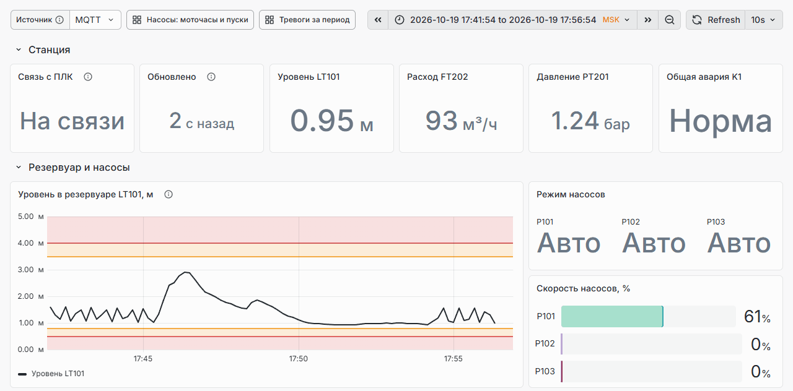
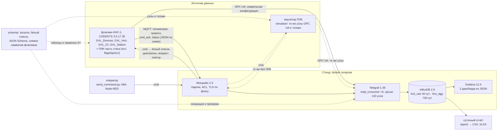

<p align="center">
  <picture>
    <source media="(prefers-color-scheme: dark)" srcset="docs/media/banner-dark.svg">
    <source media="(prefers-color-scheme: light)" srcset="docs/media/banner-light.svg">
    
  </picture>
</p>

<p align="center">
  <a href="https://github.com/kr0nsch/plc-iiot-stack/actions/workflows/ci.yml"></a> <a href="LICENSE"></a>
     
  <a href="#тесты-и-качество"></a>
</p>

<p align="center"><a href="#что-это-и-зачем">Что это</a> · <a href="#как-это-выглядит">Как выглядит</a> · <a href="#быстрый-старт">Быстрый старт</a> · <a href="#как-использовать-в-своём-проекте">В своём проекте</a> · <a href="#как-устроено">Как устроено</a> · <a href="#документация">Документация</a> · <a href="#summary-en">Summary (EN)</a></p>

**От датчика до дашборда: данные ПЛК насосной станции КНС-1 (CODESYS) по OPC UA и MQTT — в InfluxDB
и на дашборды Grafana, команды оператора — обратно в ПЛК с проверкой по белому списку.** Обычно такой
стенд собирают под один объект руками, и теги, топики, узлы OPC UA и дашборды расходятся с программой
ПЛК. Здесь стенд описан кодом, всё выводится из одного контракта данных и сверено с символами
настоящего ПЛК-проекта, а без ПЛК работает эмулятор с теми же узлами. Для инженеров АСУ ТП и SCADA,
техлидов у интеграторов.

## Что это и зачем

Четыре части вокруг одного контракта данных (`schema/`, [docs/data_schema.md](docs/data_schema.md)):

| Часть | Что делает |
|---|---|
| стенд `docker-compose.yml` | Mosquitto (логины, ACL, TLS по флагу) → Telegraf (MQTT и OPC UA) → InfluxDB 2 → Grafana с тремя дашбордами из JSON; `make up`, `make demo`, `make down` |
| эмулятор ПЛК `emulator/` | OPC UA-сервер (asyncua) с узлами флагмана и модель КНС: резервуар, три насоса с ПЧ, логика станции, сценарий отказов; публикатор MQTT и шлюз команд по контракту |
| ПЛК-часть на ST | публикация телеметрии и тревог в MQTT по изменению и периодически, шлюз команд с белым списком и диапазонами, диагностика связи; ядро в `src/`, привязка к переменным флагмана в `flagship/src/` |
| суточный отчёт `report/` | InfluxDB (Flux) или OPC UA → CSV и XLSX: уровень, откачано, моточасы и пуски, тревоги |

Объект — вымышленная КНС-1 из флагмана портфолио kns-pump-station (CODESYS 3.5.17.30, библиотека
plc-process-lib): уровнемер, три насоса с ПЧ, коллектор, вспомогательные системы, станция и регулятор
уровня.

**Что даёт:**

- Один источник имён. Узлы OPC UA Telegraf, топики, тексты тревог, дашборды, таблицы ПЛК и привязка ST
  генерируются из `schema/`; `--check` в CI не пропустит ручную правку или забытую генерацию.
- Сверка с настоящим ПЛК-проектом, а не с заглушкой. Каждый из 133 узлов OPC UA, 86 команд белого
  списка и 914 тегов эмулятора проверен по снимку символов флагмана: переменная существует, выгружается
  в OPC UA, тип совпадает, а писать можно только в структуры команд — так же, как разрешают правила
  символьной конфигурации флагмана.
- Команды обратно в ПЛК — безопасно: 10 проверок по порядку контракта (retain, схема, версия, топик,
  белый список, диапазон, возраст, повтор, частота, ответ устройства) и ровно один ответ `cmd_ack`.
- Стенд без железа и без CODESYS: эмулятор даёт те же узлы OPC UA и топики, интеграционные тесты идут
  на нём; на Windows без Docker — тот же стенд обычными процессами.
- Безопасность описана, а не подразумевается: пользователи рантайма, политики OPC UA, TLS и ACL MQTT,
  зоны и каналы в духе МЭК 62443 ([docs/security.md](docs/security.md)).

**Для кого.** Инженеры АСУ ТП и SCADA, техлиды у интеграторов и вендоров ПЛК — как пример того, как
вывести данные ПЛК в базу временных рядов и на дашборды и вернуть команды обратно так, чтобы имена и
права сходились с программой ПЛК, и как проверять это без железа.

<details>
<summary>Термины: OPC UA, символьная конфигурация, MQTT, retain, LWT, QoS, NE 107, ISA-18.2, Telegraf, Flux</summary>

| Термин | Что это |
|---|---|
| OPC UA | промышленный протокол обмена клиент — сервер; рантайм CODESYS — сервер, Telegraf и SCADA — клиенты |
| символьная конфигурация | объект проекта CODESYS: какие переменные видны по OPC UA и с какими правами (чтение, запись) |
| MQTT | протокол «публикация — подписка» через брокер; ПЛК публикует, Telegraf и HMI подписываются |
| retain | брокер хранит последнее сообщение топика и отдаёт его новому подписчику: текущее значение и состояние тревоги |
| LWT (завещание) | сообщение, которое брокер публикует сам при обрыве связи с клиентом: узел PLC1 — «offline» |
| QoS 1 | доставка «хотя бы один раз» |
| NAMUR NE 107 | статусы диагностики устройства: норма, нужно ТО, вне спецификации, проверка функции, отказ |
| ISA-18.2 | стандарт управления тревогами: состояния (активна, квитирована, отложена, подавлена) |
| Telegraf, InfluxDB, Flux, Grafana | сбор данных, база временных рядов, её язык запросов, дашборды |
| флагман | проект портфолио kns-pump-station: программа КНС-1 в CODESYS с моделью объекта |

</details>

## Как это выглядит

Снято на машине разработки с реальных прогонов: локальный стенд без Docker
(`tools_project/local_stack.ps1`, те же конфигурации, что в docker compose), эмулятор ПЛК вместо
железа, CODESYS 3.5.17.30 и CODESYS Control Win V3. Макетов нет.

<p align="center">
  <picture>
    <source media="(prefers-color-scheme: dark)" srcset="docs/media/demo-grafana-overview-dark.gif">
    <source media="(prefers-color-scheme: light)" srcset="docs/media/demo-grafana-overview-light.gif">
    
  </picture>
</p>
<p align="center"><sub>Обзор станции: Grafana 12.4.12 на локальном стенде, кадр раз в 15 с в течение 14 мин, окно 15 минут
зафиксировано от начала съёмки; модельное время эмулятора ускорено в 60 раз. GIF и снимки — в теме
оформления GitHub у читателя (светлая или тёмная)</sub></p>

<table>
<tr>
<td width="50%"><a href="docs/media/shot-grafana-pumps-light.png"><picture>
    <source media="(prefers-color-scheme: dark)" srcset="docs/media/shot-grafana-pumps-top-dark.png">
    <source media="(prefers-color-scheme: light)" srcset="docs/media/shot-grafana-pumps-top-light.png">
    
  </picture></a></td>
<td width="50%"><a href="docs/media/shot-grafana-alarms-light.png"><picture>
    <source media="(prefers-color-scheme: dark)" srcset="docs/media/shot-grafana-alarms-top-dark.png">
    <source media="(prefers-color-scheme: light)" srcset="docs/media/shot-grafana-alarms-top-light.png">
    
  </picture></a></td>
</tr>
<tr>
<td align="center"><sub>Насосы: моточасы и пуски за последние 30 минут (≈ 30 ч модельного времени); цвет насоса — один на всех дашбордах</sub></td>
<td align="center"><sub>Тревоги за период: события ISA-18.2, восстановленные из слов тревог; приоритеты — по серьёзности</sub></td>
</tr>
</table>

<details>
<summary>Полные снимки трёх дашбордов — обзор станции в момент аварии насоса P103</summary>
<p align="center">
  <picture>
    <source media="(prefers-color-scheme: dark)" srcset="docs/media/shot-grafana-overview-dark.png">
    <source media="(prefers-color-scheme: light)" srcset="docs/media/shot-grafana-overview-light.png">
    
  </picture>
</p>
<p align="center">
  <picture>
    <source media="(prefers-color-scheme: dark)" srcset="docs/media/shot-grafana-pumps-dark.png">
    <source media="(prefers-color-scheme: light)" srcset="docs/media/shot-grafana-pumps-light.png">
    
  </picture>
</p>
<p align="center">
  <picture>
    <source media="(prefers-color-scheme: dark)" srcset="docs/media/shot-grafana-alarms-dark.png">
    <source media="(prefers-color-scheme: light)" srcset="docs/media/shot-grafana-alarms-light.png">
    
  </picture>
</p>
<p align="center"><sub>Снято подряд, окно «последние 30 минут», светлая и тёмная тема — одновременно; авария ПЧ насоса P103
(тревога P103.EXT) — событие автоматического сценария отказов эмулятора, <code>emulator/iiot_emulator/faults.py</code>.
Файлы целиком: обзор — <a href="docs/media/shot-grafana-overview-light.png">светлая</a> · <a href="docs/media/shot-grafana-overview-dark.png">тёмная</a>, насосы — <a href="docs/media/shot-grafana-pumps-light.png">светлая</a> · <a href="docs/media/shot-grafana-pumps-dark.png">тёмная</a>,
тревоги — <a href="docs/media/shot-grafana-alarms-light.png">светлая</a> · <a href="docs/media/shot-grafana-alarms-dark.png">тёмная</a></sub></p>
</details>

<p align="center">
  
</p>
<p align="center"><sub>Запуск стенда и интеграционные тесты: реальный вывод PowerShell, снят term2gif.py 16.10.2026; паузы ожидания
сокращены. Тогда тестов было 12, после привязки к флагману — 14 (все пройдены 19.10.2026)</sub></p>

<p align="center">
  
</p>
<p align="center"><sub>Импорт, сборка и тесты coUnit одной командой <code>cds.py test</code>: реальный прогон CODESYS 3.5.17.30
16.10.2026, ещё с заглушкой флагмана; ожидание сборки сокращено. После привязки к флагману в CODESYS не
запускалось (<a href="#тесты-и-качество">Тесты и качество</a>)</sub></p>

## Быстрый старт

### Стенд на эмуляторе — без ПЛК и CODESYS

Нужны Python 3.11+ и git; дальше — Docker с compose v2 или Windows без Docker.

1. Клонировать и поставить зависимости проверок и инструментов:

   ```bash
   git clone https://github.com/kr0nsch/plc-iiot-stack.git
   cd plc-iiot-stack
   python -m pip install -r requirements-dev.txt
   ```

2. Поднять стенд с эмулятором.

   **docker compose:** `make demo` (на Windows с Docker Desktop — `powershell -File tools_project\make.ps1 demo`).
   Создаёт `.env` со случайными паролями, собирает образ эмулятора, поднимает стенд и ждёт данные не
   дольше 300 с. Увидите, что команда завершилась, когда в InfluxDB есть телеметрия, узел PLC1 сообщил о
   рождении и Grafana видит три дашборда.

   **Windows без Docker** (без прав администратора; сборки InfluxDB, Telegraf и Grafana для Windows тех же
   версий, брокер amqtt вместо Mosquitto):

   ```powershell
   powershell -ExecutionPolicy Bypass -File tools_project\local_stack.ps1 install          # один раз
   powershell -ExecutionPolicy Bypass -File tools_project\local_stack.ps1 start -Emulator
   ```

   Увидите, через 30–40 с: `emulator готов`, затем
   `[    5 с] свежих точек LT101/level — 3, PLC1 online — да, дашбордов нет — 0` и адрес дашборда.

3. Открыть Grafana: http://localhost:3000 (логин и пароль — `GRAFANA_ADMIN_USER`, `GRAFANA_ADMIN_PASSWORD`
   в `.env`). «КНС-1: обзор станции» — уровень, насосы, общая авария, связь с ПЛК; «Насосы: моточасы и
   пуски»; «Тревоги за период» — сценарий отказов эмулятора даёт первые тревоги через несколько минут
   (дверь павильона, сероводород, авария ПЧ).

4. Отправить команду и получить ответ ПЛК (эмулятора):

   ```bash
   python tools_project/send_command.py P103 SpeedSp 70
   python tools_project/send_command.py KNS1 SetStepped     # станция: ступенчатое регулирование
   python tools_project/send_command.py P101 SetOos         # нет в белом списке
   ```

   Увидите ответы `cmd_ack`: для первых двух — `"result": "accepted", "reason": "ok"`, для третьей —
   `"result": "rejected", "reason": "not_whitelisted"`. Станцию вернуть — `KNS1 SetLevelPid`.

5. Проверить путь данных целиком: `make test-stack` (docker compose) или
   `python -m pytest -m stack tests_stack` (локальный стенд). Увидите `14 passed`: все 139 метрик каталога
   по MQTT и все 133 узла OPC UA, ACL брокера, отказ команды вне белого списка, команда станции, агрегаты
   задачи прореживания. Остановка — `make down` или `local_stack.ps1 stop`.

Проверки без стенда (как в CI): `python -m ruff check .`, `python -m ruff format --check .`,
`python -m mypy`, `python -m pytest` — увидите `849 passed, 15 skipped` (пропущены 14 интеграционных
тестов стенда и один тест только для POSIX; с поднятым стендом — `863 passed, 1 skipped`). Подробно, с примерами вывода и частыми проблемами, —
[docs/USAGE.md](docs/USAGE.md).

<details>
<summary><b>Проверки ST без CODESYS: сборка, линтер, iec_checker, RuSTy</b></summary>

| Команда | Что делает | Увидите |
|---|---|---|
| `python tools/assemble.py --tests` | склеивает исходники ST в `build/assembled/` для анализаторов | `assemble: 70 объектов (iec), …` |
| `python tools/check/st_lint.py --strict` | линтер ST: раскладка, заголовки, имена, «магические числа» | `st_lint: файлов 496, ошибок 0, предупреждений 0` |
| `python tools/check/run_iec_checker.py --tests` | статанализ iec_checker v0.4 с файлом обоснований | `run_iec_checker (v0.4): файлов 70; необоснованных 0, обоснованных 1177, …` |
| `python tools/check/run_rusty.py` | синтаксис и типы компилятором RuSTy (`plc --check`), необязательно | 293 ошибки — расширения CODESYS, которых нет в RuSTy ([разбор](docs/STATIC_ANALYSIS.md#rusty-plc---check)) |

iec_checker и RuSTy в репозиторий не входят: iec_checker v0.4 — из
[релиза v0.4](https://github.com/iec-checker/iec-checker/releases/tag/v0.4) (путь — `--binary`, переменная
`IEC_CHECKER` или `~/.local/plc-tools/iec-checker/`), RuSTy v1.0.6 — из
[релиза v1.0.6](https://github.com/PLC-lang/rusty/releases/tag/v1.0.6) (`RUSTY_PLC`, `RUSTY_STDLIB_INCLUDE`).
Подробно — [tools/README.md](tools/README.md).

</details>

### С CODESYS: ядро шлюза в программном ПЛК

| Что нужно | Версия | Где взять |
|---|---|---|
| Windows | проверено на Windows 11 | — |
| CODESYS с CODESYS Control Win V3 | 3.5.17.30 (V3.5 SP17 Patch 3) | [MANUAL_STEPS.md, раздел 1](docs/MANUAL_STEPS.md#1-установка-codesys-351730) |
| coUnit | 1.2.0.0 | [MANUAL_STEPS.md, раздел 2](docs/MANUAL_STEPS.md#2-counit-cfunit-1200) |

1. Один раз — рантайм в пользовательском процессе, без прав администратора:
   `python tools\codesys\cds.py runtime init`.
2. `python tools\codesys\cds.py build --tests` — импорт `src/` и `tests/` в проект и сборка;
   `python tools\codesys\cds.py test` — загрузка в Control Win и прогон coUnit. Прогон 19.10.2026:
   0 ошибок, 0 предупреждений, 85 тестов из 85 ([TEST_REPORT.md](docs/TEST_REPORT.md)).
3. Во флагмане: `python tools_project\flagship_embed.py --repo <рабочая копия kns-pump-station>` — ядро,
   привязка, задача, символы и тесты; затем там `cds.py build` и `cds.py test` (19.10.2026 — 423 из 423,
   [MANUAL_STEPS.md, раздел 11](docs/MANUAL_STEPS.md#11-встраивание-во-флагман)).

### С CODESYS: стенд против флагмана по OPC UA

Флагман kns-pump-station в приложении имитации (`python tools_project/codesys/sim.py start` в его
репозитории) отдаёт те же узлы OPC UA, что эмулятор. Стенду — `OPCUA_ENDPOINT` рантайма
(`opc.tcp://host.docker.internal:4840` для docker compose, `opc.tcp://127.0.0.1:4840` без Docker),
политика `Basic256Sha256` / `SignAndEncrypt` и вход по имени (в `.env` или в окружении запуска — оно важнее
`.env`); стенд — без эмулятора (`make up` или `local_stack.ps1 start`); сертификат Telegraf — из карантина
рантайма в доверенные; проверка — `python tools_project/opcua_live_check.py` и Grafana, «Источник» = `opcua`.
Пошагово — [MANUAL_STEPS.md, раздел 12](docs/MANUAL_STEPS.md#12-стенд-против-флагмана-в-codesys-opc-ua).
Проверено 19.10.2026 без Docker: 133 узла из 133 со статусом Good в InfluxDB.

## Как использовать в своём проекте

**Сценарий 1 — вывести данные своего ПЛК в базу и на дашборды.** Подключить стенд к OPC UA-серверу
своего рантайма CODESYS (как с флагманом, раздел выше) и описать в `schema/` свои метрики: устройство,
имя метрики, тег, вид, зона нечувствительности, путь в ПЛК. Из каталога генерируются узлы OPC UA
Telegraf, тексты тревог, дашборды и таблицы ПЛК. Если теги объекта строит генератор iolistgen, тот же
перечень сигналов даёт и `scada_tags.csv` для `schema/source/`.

**Сценарий 2 — публикация из ПЛК и команды по MQTT.** Ядро шлюза `src/` (ФБ MQTT, JSON, таблицы схемы)
от объекта не зависит; привязку к своим переменным генерирует `tools_project/gen_plc_iiot.py` по колонке
`plc_path` каталога и белого списка. Для флагмана это `flagship/src/`; встраивание (константы, задача после
`PRG_Devices`, символы, тесты) — `tools_project/flagship_embed.py`, клиент MQTT — вручную
([MANUAL_STEPS.md, раздел 11](docs/MANUAL_STEPS.md#11-встраивание-во-флагман)).

**Пример: новая метрика — ошибка регулятора уровня LIC101.** Строка в `schema/telemetry_catalog.csv`
после `LIC101;out;…`:

```text
LIC101;err;LIC101.Err;analog;%;0.5;;;Application.GVL_Station.fbLIC101.stSts.rErr_pct;;Регулятор уровня LIC101: ошибка регулирования, % диапазона
```

Затем:

```bash
python tools_project/gen_config.py      # записан: telegraf/telegraf.d/opcua.conf, docs/data_schema.md
python tools_project/gen_plc_iiot.py    # записан: src/GVLs/Generated/GVL_IiotMap.gvl.st, …/FB_IiotKnsMap/FillPoints.method.impl.st
python -m pytest tests_stack            # путь rErr_pct — настоящая переменная флагмана типа REAL, только чтение
```

Telegraf получает 134-й узел OPC UA, `GVL_IiotMap.POINT_COUNT` становится 140, а `FillPoints` —
строку `REAL_TO_LREAL(GVL_Station.fbLIC101.stSts.rErr_pct)`. Копию каталога — в
`emulator/iiot_emulator/data/` (тест сверяет копии побайтно), после перезапуска стенда метрика пойдёт по
обоим путям. Ошибка в пути (например, `rErr` без `_pct`) — тест привязки падает с сообщением «у
PL.ST_PidSts нет поля rErr, видимого в символах».

Подробно — [docs/USAGE.md, раздел 6](docs/USAGE.md#6-свой-объект-вместо-кнс-1).

## Как устроено



- **Два пути в одну модель хранения**: ПЛК публикует MQTT сам (по изменению с зоной нечувствительности
  и раз в 60 с), Telegraf параллельно опрашивает OPC UA. Оба пишут `telemetry` с тегом `source`.
- **Схема данных 1.1**: топики `site/area/unit/device/metric`, JSON Schema 2020-12 на каждый класс
  сообщений, `schema_version` в каждом сообщении ([docs/data_schema.md](docs/data_schema.md)).
- **Привязка к флагману**: снимок символов флагмана (`tools_project/flagship_snapshot.py` → `schema/source/`)
  и проверка каждого пути по нему; что было вместо этого раньше и что с чем сопоставлено —
  [ARCHITECTURE.md, раздел 11](docs/ARCHITECTURE.md#11-привязка-к-флагману-кнс-1).
- **InfluxDB 2, а не TimescaleDB** — обоснование и риски в
  [ARCHITECTURE.md, раздел 4](docs/ARCHITECTURE.md#4-выбор-базы-influxdb-2-а-не-timescaledb).

| Каталог | Что внутри | Кто пишет |
|---|---|---|
| `schema/` | контракт: JSON Schema, топики, каталог метрик, белый список, примеры сообщений | вручную |
| `schema/source/` | теги и тревоги флагмана, снимок его символов и правил OPC UA | `tools_project/flagship_snapshot.py` |
| `docker-compose*.yml`, `mosquitto/`, `influxdb/`, `telegraf/telegraf.conf`, `grafana/provisioning/` | стенд как код | вручную |
| `telegraf/telegraf.d/`, `telegraf/lookup/`, `grafana/dashboards/` | узлы OPC UA, тексты тревог, дашборды | `tools_project/gen_config.py` |
| `src/` | ядро шлюза MQTT на ST: ФБ телеметрии, тревог, команд, диагностики, JSON, таблицы схемы | вручную и `gen_plc_iiot.py` (`GVL_IiotMap`) |
| `flagship/src/` | привязка к переменным флагмана: `PRG_Iiot`, `FB_IiotKnsMap` (собирается во флагмане) | вручную и `gen_plc_iiot.py` |
| `tests/` | тесты coUnit ядра | вручную |
| `adapters/` | адаптер `I_MqttClient` на библиотеку CODESYS-MQTT (не собран с ней) | вручную |
| `emulator/` | эмулятор ПЛК: модель КНС, OPC UA-сервер, MQTT, тесты | вручную |
| `report/` | суточный отчёт CSV и XLSX | вручную |
| `tools_project/` | генераторы, снимок флагмана, `send_command.py`, локальный стенд, ожидание готовности | вручную |
| `tests_stack/` | pytest: схемы, каталог, Telegraf, дашборды, compose, привязка к флагману, интеграционные тесты стенда | вручную |
| `tools/` | инструменты из plc-repo-template: `cds.py`, `assemble`, `st_lint`, обёртки iec_checker и RuSTy | шаблон |

## Тесты и качество

| Что проверяется | Сколько | Где |
|---|---:|---|
| контракт, генераторы, Telegraf, дашборды, compose, локальный стенд, точные JSON ПЛК против JSON Schema | 295 | pytest, `tests_stack/` (без поднятого стенда) |
| привязка к флагману: пути, типы и права каталога, белого списка, тегов эмулятора, узлов Telegraf и ST по снимку символов; встраивание во флагман | 27 + 8 | pytest, `tests_stack/test_flagship_binding.py`, `test_flagship_embed.py` |
| инструменты из plc-repo-template | 534 | pytest, `tools/tests/` |
| эмулятор: модель, шлюз команд, OPC UA и MQTT на 127.0.0.1, станция и LIC101, сообщения по схеме | 101 | pytest, `emulator/tests/` |
| отчёт: агрегаты, CSV и XLSX, OPC UA, записанные данные эмулятора | 89 + 1 на стенде | pytest, `report/tests/` |
| сквозной путь на поднятом стенде: 139 метрик по MQTT, 133 узла OPC UA со статусом Good, ACL, версия схемы, LWT, аудит и отказ команд, команда станции, агрегаты прореживания | 15 | pytest `-m stack`, `tests_stack/test_stack_integration.py` |
| ядро ST: JSON, функции, телеметрия, тревоги, шлюз команд, диагностика, таблицы схемы | 85 тестов, 8 наборов | coUnit, `tests/` |
| привязка во флагмане: метрики из настоящих переменных, инверсия K1, запись команд, счётчик команды станции, `PRG_Iiot` до ответа `accepted` | 5 тестов, 1 набор | coUnit, `flagship/tests/` (в тестовом приложении флагмана) |
| линтер и статанализ ST | 0 необоснованных находок | `st_lint`, iec_checker 0.4 — [STATIC_ANALYSIS.md](docs/STATIC_ANALYSIS.md) |

Что где выполнялось:

- **Локально, Windows 11, 19.10.2026**: ruff, mypy, pytest (864 пройдено, 16 пропущено без стенда), эмулятор (101),
  отчёт; локальный стенд без Docker на эмуляторе — 15 интеграционных тестов из 15, 42 панели дашбордов без
  ошибок (38–39 с данными, остальные — пустые списки отклонений), тревога станции `KNS1.NOAUTO` дошла до InfluxDB с
  текстом; st_lint и iec_checker без необоснованных находок.
- **CODESYS 3.5.17.30, CODESYS Control Win V3, 19.10.2026**: ядро здесь — сборка без ошибок и
  предупреждений, 85 тестов coUnit из 85. Во флагмане kns-pump-station (`58fc169`) со встроенной ПЛК-частью —
  сборка с `PRG_Iiot` в `MainTask` без ошибок и предупреждений, 423 теста coUnit из 423 (333 флагмана, 85 ядра,
  5 привязки).
- **Стенд против рантайма флагмана, 19.10.2026** (приложение имитации, без Docker): вход Basic256Sha256 по
  имени, доверие сертификату Telegraf, пространство имён 4 и префикс `|var|CODESYS Control Win V3.`, 133
  узла из 133 со статусом Good и типами по снимку (перечисления — Int16), инверсия K1, команды станции и
  LIC101 по OPC UA (`uiCmdSeq` растёт, `eCmdResult` — Accepted) — [TEST_REPORT.md](docs/TEST_REPORT.md#встраивание-во-флагман-и-стенд-против-его-рантайма).
- **Не проверялись**: обмен по MQTT из ПЛК, стенд в docker compose против рантайма, ПЛК210.
- **CI GitHub Actions (Linux)**: проверки без CODESYS, эмулятор и отчёт, стенд docker compose с нуля
  (`make demo DEV=1`, `make test-stack`); необязательные — RuSTy и iec_checker nightly.

## Документация

| Документ | На какой вопрос отвечает |
|---|---|
| [docs/USAGE.md](docs/USAGE.md) | как поднять стенд, где смотреть насосы и тревоги, как отправить команду, как подключить флагман, как перенести на свой объект |
| [docs/ARCHITECTURE.md](docs/ARCHITECTURE.md) | из каких сервисов стенд, как идут данные, почему InfluxDB, как устроен локальный стенд, что с чем сопоставлено во флагмане |
| [docs/data_schema.md](docs/data_schema.md) | какие топики и сообщения, каталог метрик, белый список, модель InfluxDB, версии схемы |
| [docs/plc_mqtt.md](docs/plc_mqtt.md) | как устроена ПЛК-часть: ФБ, проверки команд, тревоги, адаптер MQTT, привязка к флагману |
| [docs/security.md](docs/security.md) | пользователи рантайма, политики OPC UA, TLS и ACL MQTT, зоны и каналы, КИИ |
| [docs/MANUAL_STEPS.md](docs/MANUAL_STEPS.md) | шаги в CODESYS: установка, рантайм, сборка и тесты, библиотека MQTT, символьная конфигурация, встраивание во флагман, стенд против флагмана |
| [docs/ASSUMPTIONS.md](docs/ASSUMPTIONS.md) | какие допущения приняты и что ещё сверить |
| [docs/TEST_REPORT.md](docs/TEST_REPORT.md), [docs/STATIC_ANALYSIS.md](docs/STATIC_ANALYSIS.md) | что прогнано в CODESYS и без него, какие находки статанализа обоснованы |
| [emulator/README.md](emulator/README.md), [report/README.md](report/README.md), [flagship/README.md](flagship/README.md) | эмулятор, отчёт, привязка к флагману |
| [tools/README.md](tools/README.md) | справочник по `cds.py`, `assemble`, `st_lint`, обёрткам iec_checker и RuSTy |
| [docs/LAYOUT.md](docs/LAYOUT.md), [CONTRIBUTING.md](CONTRIBUTING.md) | как разложены исходники ST и какие правила кода |
| [CHANGELOG.md](CHANGELOG.md) | что изменилось |

## Ограничения и планы

- Привязка к флагману собрана и проверена тестами coUnit в его рабочей копии, путь OPC UA — с его
  рантаймом (19.10.2026); в сам репозиторий флагмана ПЛК-часть не встроена: нужны его правки
  ([flagship-patches/](docs/flagship-patches/README.md)) и `flagship_embed.py`
  ([MANUAL_STEPS.md, разделы 11–12](docs/MANUAL_STEPS.md#11-встраивание-во-флагман)). Сертификат клиента,
  который создаёт Telegraf, действует год — доверие к нему на рантайме нужно обновлять.
- Библиотека CODESYS-MQTT (1.0.0.0) на CODESYS 3.5.17.30 не собирается: нет её зависимостей. Логика MQTT
  проверена с подменным клиентом, адаптер с библиотекой не компилировался; без адаптера ПЛК-часть
  работает с клиентом без транспорта. Поэтому с флагманом сейчас работает только путь OPC UA.
- Модель станции в эмуляторе упрощённая: ПИД уровня изображается пропорциональным заданием частоты,
  тревоги LDEV и SIM не возникают; узлы, типы и права — как у флагмана.
- События тревог ПЛК восстанавливаются по словам тревог: переходы между публикациями сливаются; точные
  события даст приёмник `PL.I_AlarmSink` plc-process-lib во флагмане.
- Эмулятор ускоряет модельное время в 60 раз, метки времени — реальные: моточасы и пуски растут в
  60 раз быстрее расхода. Для правдоподобного суточного отчёта — `EMU_TIME_FACTOR=1`.
- На дашбордах нет отдельных панелей станции KNS1 и LIC101 (данные в базе есть); отчёт не считает
  тревоги станции.
- Стенд docker compose целиком проверяется в CI на Linux; локально тот же путь проверен на сборках для
  Windows (отличия — [ARCHITECTURE.md, раздел 10](docs/ARCHITECTURE.md#10-локальный-стенд-без-docker)).
- Flux в InfluxDB 2 не развивается: переход на InfluxDB 3 потребует переписать запросы дашбордов и отчёта.
- Дальше: клиент MQTT, который собирается на 3.5.17.30, и живой обмен по MQTT с флагманом, встраивание в
  репозиторий флагмана, панели станции.

## Связанные проекты

Репозиторий — часть портфолио АСУ ТП (таблица ниже). Объект и символы — из флагмана kns-pump-station
(готовится к публикации), типы устройств — из библиотеки
[plc-process-lib](https://github.com/kr0nsch/plc-process-lib), теги и тревоги устройств флагмана
строит генератор по перечню сигналов [iolistgen](https://github.com/kr0nsch/iolistgen), раскладку ST
в git и инструменты `tools/` даёт шаблон [plc-repo-template](https://github.com/kr0nsch/plc-repo-template);
общий CI для таких репозиториев — [plc-ci-toolkit](https://github.com/kr0nsch/plc-ci-toolkit), здесь
пока свой `ci.yml`. Соседние примеры того же подхода — [sis-interlock-demo](https://github.com/kr0nsch/sis-interlock-demo)
(логика ПАЗ и тесты из матрицы причин и следствий) и [s7-to-codesys](https://github.com/kr0nsch/s7-to-codesys)
(перенос SCL в ST с отчётом).

## Summary (EN)

An infrastructure-as-code IIoT stand for a (fictional) sewage pumping station: PLC data flows over
OPC UA and MQTT through Telegraf into InfluxDB 2 and three provisioned Grafana dashboards, while
operator commands travel back and are checked in the PLC against a whitelist with value ranges. Everything
is generated from one data contract and bound to the real CODESYS 3.5.17.30 flagship project: a snapshot
of its symbols verifies that each of the 133 OPC UA nodes, 86 whitelisted commands and 914 emulator tags
is a real exported variable of the right type, and that writes go only to command structures. Embedded
into the flagship, the PLC part builds cleanly and passes 423 of 423 coUnit tests there, and the Telegraf
OPC UA path reads all 133 nodes from the flagship runtime with status Good. A Python
PLC emulator serves the same nodes and topics, so `make demo` runs without a PLC. Includes a CODESYS ST
gateway (telemetry, alarms, command gateway, link diagnostics), a daily CSV/XLSX report and a security
guide. Docs are in Russian.

## Лицензия

[MIT](LICENSE) © 2026 kr0nsch

---

<p align="center"><b>Портфолио АСУ ТП</b></p>
<table>
<tr><td width="33%"><a href="https://github.com/kr0nsch/plc-repo-template">01 · plc-repo-template</a><br><sub>ST в git, сборка проекта скриптом, CI</sub></td><td width="33%"><a href="https://github.com/kr0nsch/plc-process-lib">02 · plc-process-lib</a><br><sub>ФБ: AI, двигатель, ПЧ, задвижка, ПИД, тревоги</sub></td><td width="33%"><a href="https://github.com/kr0nsch/kns-pump-station">03 · kns-pump-station</a><br><sub>флагман: КНС, три насоса с ПЧ, модель, ПМИ</sub></td></tr>
<tr><td width="33%"><a href="https://github.com/kr0nsch/kns-port-domestic">04 · kns-port-domestic</a><br><sub>перенос на Astra.IDE / MasterSCADA 4D</sub></td><td width="33%"><a href="https://github.com/kr0nsch/plc-iiot-stack"><b>05 · plc-iiot-stack</b></a><br><sub>OPC UA / MQTT → InfluxDB → Grafana</sub></td><td width="33%"><a href="https://github.com/kr0nsch/iolistgen">06 · iolistgen</a><br><sub>перечень сигналов → ST, карты Modbus, SCADA</sub></td></tr>
<tr><td width="33%"><a href="https://github.com/kr0nsch/plc-ci-toolkit">07 · plc-ci-toolkit</a><br><sub>линтеры, сборка CODESYS, тесты, JUnit</sub></td><td width="33%"><a href="https://github.com/kr0nsch/s7-to-codesys">08 · s7-to-codesys</a><br><sub>конвертер SCL → ST с отчётом о переносе</sub></td><td width="33%"><a href="https://github.com/kr0nsch/sis-interlock-demo">09 · sis-interlock-demo</a><br><sub>ПАЗ: MooN, матрица причин и следствий</sub></td></tr>
</table>
