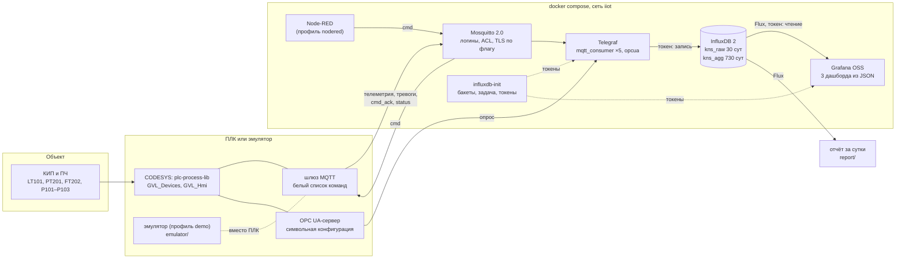
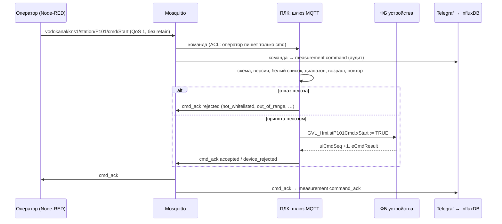

# Архитектура стенда

Стенд «от датчика до дашборда»: данные ПЛК КНС-1 (флагман портфолио) через MQTT и OPC UA попадают
в InfluxDB 2 и на дашборды Grafana, команды идут обратно через брокер и проверяются в ПЛК. Без ПЛК
стенд работает на эмуляторе. Инфраструктура описана кодом: `docker-compose.yml` и конфигурация
сервисов в репозитории, секреты — в `.env`.

Схема данных (топики, сообщения, модель хранения) — [data_schema.md](data_schema.md), безопасность —
[security.md](security.md).

## 1. Обзор



Два пути данных намеренно сходятся в одну модель хранения: MQTT (ПЛК публикует сам, по изменению
и периодически) и OPC UA (Telegraf опрашивает сервер ПЛК). Оба пишут measurement `telemetry`
с одинаковыми `device`/`metric`; тег `source` (`mqtt`/`opcua`) отличает путь, дашборды выбирают его
переменной «Источник». Так видно, что оба пути дают одни и те же значения, и стенд работает с любым
из них.

## 2. Сервисы

| Сервис | Образ | Роль | Порт на хосте | Проверка здоровья |
|---|---|---|---|---|
| `mosquitto` | `eclipse-mosquitto:2.0.22` | брокер MQTT: пароли и ACL из `.env`, TLS 8883 по флагу | `127.0.0.1:1883` (8883 — с `TLS=1`) | `mosquitto_sub` на `$SYS/broker/uptime` от пользователя monitor |
| `influxdb` | `influxdb:2.9.1-alpine` | база временных рядов, первичная установка из `.env` | — (`127.0.0.1:8086` с `DEV=1`) | `influx ping` |
| `influxdb-init` | `influxdb:2.9.1-alpine` | однократно: срок хранения, бакет агрегатов, задача прореживания, токены Telegraf и Grafana | — | завершение с кодом 0 |
| `telegraf` | `telegraf:1.39.3-alpine` | MQTT и OPC UA → InfluxDB, тексты тревог по коду | — | `outputs.health`: буфер вывода заполнен меньше чем наполовину |
| `grafana` | `grafana/grafana:12.4.12` | дашборды из `grafana/dashboards/*.json`, источник данных из провиженинга | `127.0.0.1:3000` | `/api/health` |
| `emulator` | сборка `docker/emulator.Dockerfile` (`python:3.12.14-slim`) | профиль `demo`: OPC UA-сервер с тегами флагмана, модель КНС, публикатор MQTT | — | TCP 4840 |
| `nodered` | `nodered/node-red:4.1.15-22` | профиль `nodered`, по желанию: пустой редактор для панели команд (готового потока нет; проверки команд — в ПЛК) | `127.0.0.1:1880` | встроенная в образ |

- Все образы закреплены по версии (тест `tests_stack/test_compose.py` не пропустит `latest`).
  Образ `grafana/grafana` — открытая редакция Grafana (OSS). В отдельном репозитории
  `grafana/grafana-oss` на Docker Hub последний тег на октябрь 2026 — 13.0.2 (июнь), поэтому взят основной.
- Ветка 12.4 Grafana выбрана вместо 13.x консервативно: классическая модель JSON дашбордов и провиженинг
  в ней проверены временем. Переход на 13.x — после прогона `make demo` и сверки дашбордов.
- Оформление дашбордов (генератор `tools_project/gen_config.py`) — по ISA-101: серый — норма, цвет —
  отклонение (приоритет тревоги ISA-18.2, статус NE 107, режим не «Авто»). Исключение — цвет насоса,
  один на всех дашбордах: P101 `#02A671`, P102 `#A167F1`, P103 `#B52A8E`, ток IT111, IT121, IT131 — цветом
  своего насоса. Эти тона не совпадают с цветами тревог и статусов, пары различимы при протанопии и
  дейтеранопии и контрастны к фону панели светлой и тёмной темы; значения и подписи — цветом текста.
  Одиночная линия процесса — цветом текста темы (видна и на тёмной). Заголовки панелей stat помещаются в
  окно шириной 1280 px, таблицы тревог переносят длинный текст тревоги — проверяет
  `tests_stack/test_grafana.py`.
- Проверки здоровья — основа порядка запуска: Telegraf ждёт здоровых брокер и базу и успешного
  `influxdb-init`; Grafana — `influxdb-init`.
- Для всех сервисов: `restart: unless-stopped` (кроме однократного), `no-new-privileges`, ротация
  журналов docker (3 × 10 МБ), именованные тома, отдельная сеть `iiot`.

## 3. Потоки данных

| Поток | Путь | Особенности |
|---|---|---|
| телеметрия | ПЛК → `{site}/{area}/{unit}/{device}/{metric}` → Telegraf → `telemetry` | QoS 1, retain; по изменению вне зоны нечувствительности и раз в 60 с |
| тревоги | ПЛК → `…/{device}/alarm/{suffix}` → Telegraf (+ текст по коду) → `alarm` | одно событие — один переход ISA-18.2; retain = текущее состояние |
| команды | Node-RED/HMI → `…/{device}/cmd/{command}` → ПЛК; журнал → `command` | без retain; проверки и белый список — в ПЛК |
| ответы | ПЛК → `…/{device}/cmd_ack/{command}` → `command_ack` | ровно один ответ на команду с читаемым `cmd_id` |
| состояние узла | ПЛК → `…/PLC1/status/connection` (рождение, LWT) → `node_status` | retain; панель «Связь с ПЛК» |
| OPC UA | Telegraf опрашивает раз в 10 с → `telemetry`, `source=opcua` | узлы — пути ПЛК из каталога; пространство имён и префикс узла — `OPCUA_NAMESPACE`, `OPCUA_ID_PREFIX` в `.env` |

Команда и ответ:



## 4. Выбор базы: InfluxDB 2, а не TimescaleDB

| Критерий | InfluxDB 2 | TimescaleDB (PostgreSQL) | Вывод для стенда |
|---|---|---|---|
| Telegraf | штатный выход `outputs.influxdb_v2`, модель «measurement/теги/поля» один в один | выход `outputs.postgresql` есть; схему таблиц и типы нужно продумать отдельно | InfluxDB проще |
| Grafana | встроенный источник InfluxDB (Flux и InfluxQL) | встроенный источник PostgreSQL, SQL с макросами времени | равны |
| Срок хранения и прореживание | срок хранения — свойство бакета; прореживание — задача Flux в самой базе (`kns_downsample_1h`) | `add_retention_policy`, непрерывные агрегаты (continuous aggregates) — тоже из коробки | равны; у InfluxDB меньше настройки |
| Язык запросов | Flux (окна, `difference`, `integral`, часовые пояса) и InfluxQL через совместимый API | полный SQL: соединения, оконные функции, внешние ключи | для временных рядов достаточно Flux; SQL сильнее для связанных данных |
| Ресурсы | один процесс, без отдельной СУБД; сжатие рядов | PostgreSQL с расширением; настройка памяти и автоочистки (vacuum) | для одного стенда и малого сервера InfluxDB легче в эксплуатации (оценка, сверить `docker stats` на стенде) |
| Отчёт за сутки | агрегаты за сутки — один запрос Flux по HTTP API: мин./макс./среднее уровня, приращения моточасов и пусков, срабатывания тревог (`report/`) | то же на SQL | соединений с другими таблицами отчёт не требует |
| Лицензия | MIT (InfluxDB OSS 2.x) | Apache 2.0 (ядро) и Timescale License (часть функций, в т. ч. сжатие) | обе допустимы для стенда |

**Решение — InfluxDB 2.** Стенд пишет только временные ряды и события, связанные с позициями
перечня; соединений с реляционными данными (заказы, справочники ТОиР) нет. Telegraf и Grafana
работают с InfluxDB без промежуточного слоя, срок хранения и прореживание задаются в самой базе.

Риски и когда выбрать TimescaleDB:
- Flux в InfluxDB 2 поддерживается, но не развивается, а InfluxDB 3 работает с SQL и InfluxQL без
  Flux. Переход: запросы дашбордов и отчёта переписать на InfluxQL/SQL; модель хранения
  (measurement, теги, поля) переносится без изменений.
- Если отчёты должны соединять данные стенда с данными ТОиР, MES или ERP, или нужна строгая
  транзакционная запись событий, — TimescaleDB (PostgreSQL) удобнее.

## 5. Хранение

| Бакет | Что | Срок | Кто пишет | Кто читает |
|---|---|---|---|---|
| `kns_raw` (`INFLUX_BUCKET`) | все measurement из data_schema.md, раздел 7 | 30 сут (`INFLUX_RETENTION`) | Telegraf (токен: запись в этот бакет) | Grafana (токен: чтение), отчёт |
| `kns_agg` (`INFLUX_BUCKET_AGG`) | `telemetry_1h`: среднее, взвешенное по времени, мин., макс. за час (без `quality = bad`) | 730 сут (`INFLUX_RETENTION_AGG`) | задача `kns_downsample_1h` | Grafana (токен: чтение) — для запросов по долгой истории; дашборды стенда и отчёт берут `kns_raw` |

- Число рядов (кардинальность): ~120 метрик × 2 источника + ~80 кодов тревог × 5 полей + команды —
  порядка тысячи рядов; для InfluxDB это мало.
- Объём (оценка, сверить на стенде): при контрольной публикации раз в 60 с и изменениях аналоговых
  сигналов — сотни тысяч точек в сутки, десятки мегабайт в сутки на диске до сжатия.
- `influxdb/influxdb-init.sh` при каждом `up` приводит сроки хранения к значениям из `.env`, создаёт
  бакет агрегатов и задачу, если их нет.

## 6. Секреты и настройки

| Где | Что |
|---|---|
| `.env.example` (в git) | все переменные с комментариями; секреты — заглушка `change-me` |
| `.env` (не в git) | рабочие значения; `make env` создаёт его со случайными паролями (права 0600 в Linux и macOS) и дописывает новые ключи после обновления `.env.example` |
| том `influx-tokens` | токены InfluxDB с минимальными правами: `telegraf.token` (запись в `kns_raw`), `grafana.token` (чтение `kns_raw` и `kns_agg`); выпускает `influxdb-init` |
| `/mosquitto/run` в контейнере | файл паролей (хэши `mosquitto_passwd`) и ACL — собираются из `.env` при каждом старте, в томах их нет |
| `mosquitto/certs/` (не в git) | локальный УЦ и сертификат брокера: `make certs` |
| том `telegraf-pki` | сертификат и ключ клиента OPC UA Telegraf (политика не None): создаются при первом старте, доверие сервера CODESYS — один раз (security.md, 4.2) |
| `GRAFANA_SECRET_KEY` (`.env`) | ключ, которым Grafana шифрует секреты в своей базе (токен источника данных) — вместо общего ключа по умолчанию |

Токен администратора InfluxDB (`INFLUX_ADMIN_TOKEN`) используется только при первичной установке
и сервисом `influxdb-init`; Telegraf и Grafana его не получают. Обязательные секреты в compose
записаны как `${VAR:?…}`: без `.env` стенд не стартует с пустыми паролями.

## 7. Сеть и порты

- Все сервисы — в сети `iiot` (bridge, имя `plc-iiot-stack`); между собой — по именам сервисов.
- На хост публикуются только Grafana (`127.0.0.1:3000`) и MQTT (`127.0.0.1:1883`). Адрес привязки
  меняется в `.env` (`GRAFANA_BIND`, `MQTT_BIND`) — осознанно, вместе с TLS.
- `make up TLS=1` (`docker-compose.tls.yml`) добавляет слушатель MQTT TLS 8883 на `MQTT_TLS_BIND`:
  к нему подключается ПЛК из сети предприятия. Без шифрования 1883 остаётся только внутри стенда и
  на 127.0.0.1.
- `make up DEV=1` (`docker-compose.dev.yml`) открывает InfluxDB на `127.0.0.1:8086` для отчёта с хоста.
- OPC UA-сервер CODESYS Control Win на этом же компьютере доступен Telegraf как
  `opc.tcp://host.docker.internal:4840` (`extra_hosts: host-gateway`).

Зоны и каналы в духе МЭК 62443 — [security.md](security.md).

## 8. Запуск и проверки

| Команда (Linux/macOS — `make`, Windows — `tools_project\make.ps1`) | Что делает |
|---|---|
| `make env` | `.env` из `.env.example` со случайными паролями |
| `make up` | брокер, база, сбор, дашборды; ждёт, пока сервисы станут здоровыми (`tools_project/stack_wait.py`) |
| `make demo` | то же и эмулятор; ждёт телеметрию LT101 в базе, рождение PLC1 и три дашборда в Grafana (до 5 мин) |
| `make down` / `make clean` | остановить / остановить и удалить тома |
| `make test` | pytest: схемы, каталог, Telegraf, дашборды, compose, инструменты; тесты эмулятора и отчёта |
| `make test-stack` | на поднятом стенде: интеграционные тесты «эмулятор → брокер → Telegraf → InfluxDB → запрос» (все метрики каталога, путь OPC UA, ACL, фильтр версии схемы, аудит команд, сквозной отказ команды вне белого списка и вне диапазона) и `tools_project/check_dashboards.py` — каждая панель трёх дашбордов возвращает данные |
| `make certs` | локальный УЦ и сертификат брокера (`tools_project/gen_mqtt_certs.sh`, нужен openssl) |
| `make gen` | перегенерировать узлы OPC UA Telegraf, тексты тревог, дашборды и таблицы data_schema.md из `schema/` |

Конфигурация, которая выводится из контракта данных, генерируется (`tools_project/gen_config.py`), а
тест проверяет, что сгенерированные файлы актуальны. Остальное (compose, `telegraf.conf`, провиженинг)
пишется руками и сверяется тестами с `docs/data_schema.md` и `schema/`.

CI (`.github/workflows/ci.yml`): задание `checks` — проверки без Docker, `packages` — эмулятор и
отчёт, `stack` — `make demo DEV=1` с нуля на Linux, `make test-stack` и отчёт по данным стенда. Что
проверено локально без Docker и что подтверждает только CI — раздел «Стенд docker compose и схема
данных» в [ASSUMPTIONS.md](ASSUMPTIONS.md) и раздел 10 ниже.

## 9. Контур ST (CODESYS)

Сторона ПЛК (публикация MQTT, белый список команд, диагностика связи) — тексты ST в `src/` и `tests/`
по раскладке [LAYOUT.md](LAYOUT.md). Проверки без CODESYS (линтер, iec_checker, RuSTy) идут в CI,
сборка и тесты CfUnit — в CODESYS 3.5.17.30 и Control Win V3 (`tools/codesys/cds.py`, подробно —
[tools/README.md](../tools/README.md)).

## 10. Локальный стенд без Docker

`tools_project/local_stack.ps1` (шаги — `tools_project/local_stack.py`) поднимает тот же путь данных
обычными процессами Windows, без Docker и без прав администратора: для машины разработки, где Docker
недоступен, и для снимков дашбордов. Основной и проверяемый в CI способ — docker compose.

```powershell
powershell -ExecutionPolicy Bypass -File tools_project\local_stack.ps1 install          # сборки и venv брокера
powershell -ExecutionPolicy Bypass -File tools_project\local_stack.ps1 start -Emulator  # стенд, эмулятор, ожидание данных
powershell -ExecutionPolicy Bypass -File tools_project\local_stack.ps1 status
powershell -ExecutionPolicy Bypass -File tools_project\local_stack.ps1 stop             # -Clean — удалить и данные
```

Конфигурация не дублируется. Окружение каждого сервиса читается из `docker-compose.yml` с подстановкой
`.env` по правилам compose; адреса сервисов compose (`mosquitto:1883`, `influxdb:8086`, `emulator:4840`)
заменяются на `127.0.0.1`, пути в контейнерах — на пути хоста по томам сервиса (bind-тома — каталоги
репозитория, именованные тома — `build/local-stack/volumes/<том>`). Используются те же файлы:
`telegraf/telegraf.conf` и `telegraf.d/`, `grafana/dashboards/`, `mosquitto/config/acl.template`,
`influxdb/tasks/downsample_1h.flux`.

| Компонент | docker compose | Локальный стенд | Последствия |
|---|---|---|---|
| Брокер MQTT | Mosquitto 2.0.22: файл паролей (`mosquitto_passwd`) и ACL из `.env` | amqtt 0.12.1 (Python, свой venv): те же четыре пользователя (хэши argon2), ACL разобран из того же `acl.template`; анонимный вход запрещён | у amqtt нет хранения на диске: сохранённые (retain) сообщения и очереди постоянных сессий не переживают перезапуск брокера; `max_queued_messages` и прочие настройки `mosquitto.conf` не переносятся; TLS 8883 не настраивается |
| InfluxDB | `influxdb:2.9.1-alpine`, первичная установка — переменные `DOCKER_INFLUXDB_INIT_*` образа, затем `influxdb/influxdb-init.sh` (influx CLI) | `influxd.exe` 2.9.1 (zip с dl.influxdata.com); те же шаги — `local_stack.py influx-init` через HTTP API: установка, сроки хранения, бакет `kns_agg`, задача `kns_downsample_1h`, токены Telegraf (запись) и Grafana (чтение) | в сборке для Windows нет базы часовых поясов: `install` собирает `zoneinfo.zip` из пакета tzdata (IANA) и передаёт его influxd в `ZONEINFO`, иначе `timezone.location()` дашборда «Насосы» не работает (в образе alpine база есть — пакет `tzdata`) |
| Telegraf | `telegraf:1.39.3-alpine`, токен из тома — `telegraf/docker-entrypoint.sh` | `telegraf.exe` 1.39.3 (zip); токен — из того же тома на хосте | каталог текстов тревог и адрес проверки здоровья заданы в `telegraf.conf` как `${TELEGRAF_LOOKUP_DIR:-/etc/telegraf/lookup}` и `${TELEGRAF_HEALTH_ADDRESS:-http://:8080}`: в контейнере действуют значения по умолчанию |
| Grafana | `grafana/grafana:12.4.12`, провиженинг из `grafana/provisioning` | `grafana.exe` 12.4.12 OSS (zip с dl.grafana.com); копия провиженинга в `build/local-stack/grafana/provisioning` с путями хоста и адресом `127.0.0.1:8086` | с `-AnonymousViewer` дашборды открываются без входа, только чтение и только на 127.0.0.1 — для снимков безголовым браузером; в compose анонимный доступ выключен |
| Эмулятор | образ `docker/emulator.Dockerfile`, OPC UA `opc.tcp://emulator:4840` | `python -m iiot_emulator run` из `emulator/`, OPC UA `opc.tcp://127.0.0.1:4841` | порт 4840 на машине разработки занят OPC UA-сервером службы CODESYS Control Win; Telegraf получает адрес 4841 тем же переводом адресов |
| Node-RED | профиль `nodered` | не запускается | — |

Проверка 16.10.2026 на Windows 11 (Python 3.12): `start -Emulator` — данные на дашбордах через 5 с
после запуска эмулятора; все 115 метрик каталога пришли и по MQTT, и по OPC UA (`StatusGood`); задача
`kns_downsample_1h` отработала и записала агрегаты в `kns_agg`; `python -m pytest -m stack tests_stack`
— 11 интеграционных тестов пройдены, после остановки эмулятора узел PLC1 — `offline` (завещание), и
тесты, которым нужен узел, пропускаются; `tools_project/check_dashboards.py` — у 39 из 42 панелей есть
данные, 3 списка отклонений пусты, пока всё в норме, а с включёнными через OPC UA отказами
(`Simulation.Inject`: авария ПЧ Н2, дверь, сероводород) данные есть у всех 42; суточный отчёт `report/`
по данным локальной InfluxDB построен (`report/tests/test_live_influx.py` пройден). Снимки дашбордов
для README (`docs/media/shot-grafana-*`, `demo-grafana-overview-*.gif`, светлая и тёмная тема) сняты с
этого стенда безголовым Edge (Playwright) при `start -Emulator -AnonymousViewer`.

На локальном стенде найдены и исправлены две ошибки, которые проявились бы и в compose: время точек
`node_status` (завещание ложилось раньше рождения) и панели состояния насосов (полоса «-∞+» вместо
состояний) — CHANGELOG.md, раздел Fixed.
