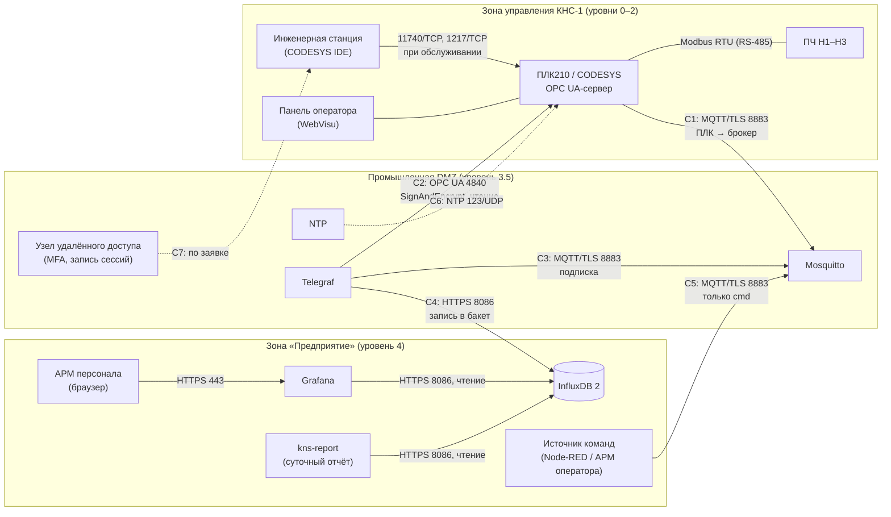

# Безопасность стенда и рабочей установки

Документ описывает, как защищены компоненты стенда «от датчика до дашборда» и что нужно изменить
для рабочей установки на объекте. Это инженерная памятка, а не проект системы защиты: оценка
рисков, модель угроз и выбор мер для конкретного объекта здесь не выполнялись.

> **Соответствие не заявляется.** Проект не утверждает соответствие требованиям приказа ФСТЭК
> России № 239, другим нормативным актам ФСТЭК России, стандартам серии МЭК 62443 (IEC 62443) или
> иным документам. Ссылки на них даны как ориентир. Подробности — в [разделе 10](#10-кии-и-требования-фстэк-россии).

Связанные документы: [data_schema.md](data_schema.md) (топики, ACL брокера, хранение),
[ARCHITECTURE.md](ARCHITECTURE.md) (секреты и настройки стенда),
[report/README.md](../report/README.md) (отчёт и его доступ к данным).

## Содержание

1. [Что защищаем и в каком порядке](#1-что-защищаем-и-в-каком-порядке)
2. [Стенд и рабочая установка: сводка различий](#2-стенд-и-рабочая-установка-сводка-различий)
3. [Пользователи и права в рантайме CODESYS](#3-пользователи-и-права-в-рантайме-codesys)
4. [OPC UA: политики безопасности и сертификаты](#4-opc-ua-политики-безопасности-и-сертификаты)
5. [MQTT: аутентификация, ACL, TLS](#5-mqtt-аутентификация-acl-tls)
6. [Сегментация сети: зоны и каналы](#6-сегментация-сети-зоны-и-каналы)
7. [Секреты](#7-секреты)
8. [Журналирование и мониторинг](#8-журналирование-и-мониторинг)
9. [Резервное копирование и восстановление](#9-резервное-копирование-и-восстановление)
10. [КИИ и требования ФСТЭК России](#10-кии-и-требования-фстэк-россии)
11. [Чек-лист усиления](#11-чек-лист-усиления)
12. [Источники](#12-источники)

## 1. Что защищаем и в каком порядке

Для АСУ ТП порядок приоритетов обратный офисному: сначала **доступность** и **целостность**
управления, потом конфиденциальность данных.

| Актив | Что плохого может случиться | Главная мера в проекте |
|---|---|---|
| Логика ПЛК и его конфигурация | загрузка чужого приложения, онлайн-изменение, остановка ПЛК | обязательное управление пользователями рантайма (с SP17), раздельные учётные записи, шифрование связи IDE ↔ ПЛК |
| Команды на насосы (`…/cmd/…`, запись по OPC UA) | пуск, останов, смена режима посторонним | белый список и проверка диапазонов в ПЛК (`schema/command_whitelist.csv`), ACL брокера, запись по OPC UA — только в структуры команд |
| Телеметрия и тревоги | подмена значений, пропуск тревоги, утечка данных о работе объекта | TLS, учётные записи с минимальными правами, контроль свежести по `ts` и состоянию узла |
| Учётные данные и ключи | захват любого из перечисленного | секреты только в `.env` и хранилищах, отдельный токен на каждую службу |

Защита команд строится в несколько слоёв: даже если брокер или учётная запись оператора
скомпрометированы, ПЛК выполняет только команды из белого списка, с допустимым значением, без
флага retain и с действующей версией схемы ([data_schema.md](data_schema.md), раздел 5). Блокировки
и защиты (сухой ход, аварийный уровень) работают в ПЛК независимо от команд сверху.

## 2. Стенд и рабочая установка: сводка различий

Стенд (`docker-compose.yml`) рассчитан на один компьютер разработчика и CI. Все контейнеры в одной
сети docker `plc-iiot-stack`, поэтому сегментация из [раздела 6](#6-сегментация-сети-зоны-и-каналы)
на стенде не воспроизводится: это логическая схема для объекта.

| Элемент | Как сделано на стенде | Что сделать на объекте |
|---|---|---|
| Порты на хосте | Grafana и MQTT 1883 — только `127.0.0.1`; InfluxDB — только с `docker-compose.dev.yml` и тоже на `127.0.0.1`; TLS 8883 — с `docker-compose.tls.yml` на `0.0.0.0` | слушатели — только на интерфейсах своей зоны, остальное закрыто межсетевым экраном (раздел 6) |
| Mosquitto | `allow_anonymous false`, файл паролей и ACL собираются из `.env`, четыре роли: `plc`, `telegraf`, `operator`, `monitor`; TLS по флагу (`make certs`, `make up TLS=1`), сертификат клиента не требуется | только TLS, порт 1883 закрыт; сертификаты от УЦ предприятия; mTLS для ПЛК; учётная запись на каждого клиента (раздел 5) |
| InfluxDB 2 | токен администратора только для первичной установки; Telegraf — токен на запись в `kns_raw`, Grafana — на чтение `kns_raw` и `kns_agg` (`influxdb/influxdb-init.sh`) | HTTPS; отдельный токен на чтение для отчёта; токен администратора хранится вне сервера |
| Grafana | пароль администратора из `.env`, порт на `127.0.0.1` | HTTPS, вход через корпоративный каталог, роли Viewer для персонала, анонимный доступ выключен |
| OPC UA эмулятора | конечные точки None и Basic256Sha256 SignAndEncrypt, самоподписанный сертификат, анонимный клиент — только чтение (`EMU_OPCUA_ALLOW_ANONYMOUS=true` в демо); сертификаты клиентов не проверяются | — (эмулятор на объекте не используется) |
| OPC UA рантайма CODESYS | Telegraf: `OPCUA_SECURITY_POLICY=None`, `Anonymous` для эмулятора; для рантайма в `.env.example` указан вариант Basic256Sha256 / SignAndEncrypt / UserName | только Basic256Sha256 или Aes128/Aes256 с режимом SignAndEncrypt, вход по пользователю, сертификаты клиентов в списке доверенных (раздел 4) |
| Контейнеры | версии образов закреплены, `no-new-privileges`, ротация журналов docker | плюс отдельный хост или ВМ на зону, обновления по графику, запрет доступа к сокету docker |
| Секреты | `.env` (в git — только `.env.example`), `make env` подставляет случайные пароли | хранилище секретов, ротация, секреты в файлах, а не в переменных окружения (раздел 7) |
| Локальный стенд без Docker (`tools_project/local_stack.ps1`) | все службы слушают только `127.0.0.1`; брокер amqtt — те же четыре пользователя (хэши argon2) и ACL из `acl.template`, анонимный вход запрещён, TLS нет; InfluxDB и токены — как на стенде; Grafana по флагу `-AnonymousViewer` показывает дашборды без входа (роль Viewer) — только для снимков экрана | — (средство разработчика, на объекте не используется) |

## 3. Пользователи и права в рантайме CODESYS

### 3.1 Что изменилось в SP17

- Для CODESYS Control SL начиная с 3.5 SP17 управление пользователями устройства **включено
  принудительно** как политика связи. На SP14–SP16 его нужно было включать явно.
- При первом подключении IDE предлагает создать первого пользователя. Он попадает в группу
  Administrator. Пароль по умолчанию в SP17 нет: учётных записей вида «Administrator /
  Administrator» из старых инструкций не существует.
- Политика паролей включена по умолчанию (`SECURITY.UserMgmt.PasswordPolicy=ENABLED`), справка не
  рекомендует её отключать. Для группы Administrator по умолчанию включена блокировка входа на
  3600 с после превышения числа попыток. Снимает её администратор (новый пароль) или перезапуск
  рантайма.
- Анонимный вход, в том числе по OPC UA, с SP17 по умолчанию запрещён. Разрешается явно в диалоге
  **Change Runtime Security Policy** на вкладке Communication Settings устройства, после чего
  нужен перезапуск рантайма.

Отключить принудительное управление пользователями можно строкой
`[CmpUserMgr] SECURITY.UserMgmtEnforce=NO` в `CODESYSControl.cfg`. **Делать этого не нужно**: на
этом стенде управление пользователями оставлено включённым, а автоматические тесты
(`tools/codesys/cds.py test`) входят под отдельным локальным пользователем, учётные данные которого
лежат в файле вне репозитория и в журналы не попадают ([tools/README.md](../tools/README.md)).

### 3.2 Группы и права

Группы по умолчанию в управлении пользователями устройства:

| Группа | Что может |
|---|---|
| Administrator | всё; первый пользователь контроллера |
| Developer | загрузка, онлайн-изменение, отладка, форсирование |
| Service | резервное копирование и восстановление приложения, загрузка загрузочного проекта; без программирования и отладки |
| Watch | только чтение |

Права (View, Modify, Execute, Add/Remove) назначаются группам на объекты рантайма на вкладке
**Access Rights** устройства. Для OPC UA-сервера справка называет объект
`RuntimeSystemObjects - RemoteConnections - OPCUAServer` и соответствие служб правам: чтение
атрибутов и подписки — View, запись — Modify, вызов методов — Execute. Права проверяются и на
уровне объекта: пользователь с правом записи на сервер может не иметь права писать конкретную
переменную. Анонимным клиентам права выдаются неявной группе `Anonymous_OPCUAServer`.

### 3.3 Минимальные права: учётные записи для этого проекта

| Учётная запись | Группа | Для чего | Права |
|---|---|---|---|
| персональная администратора (`adm.<фамилия>`) | Administrator | управление пользователями, политика безопасности | всё; не используется для повседневной работы |
| персональные инженеров (`dev.<фамилия>`) | Developer | загрузка и онлайн-изменение при пусконаладке | на объекте — по заявке, на время работ |
| `svc.backup` | Service | резервное копирование приложения | без отладки и онлайн-изменений |
| `svc.scada` | своя группа | SCADA, Telegraf по OPC UA, HMI сверху | View на OPC UA-сервер; Modify — только если команды идут по OPC UA, и только на структуры `GVL_Hmi.st<DEV>Cmd` |
| `svc.report` | своя группа (по образцу Watch) | `kns-report opcua` | только View |

Правила:

- Учётные записи персональные: с общим логином «оператор» нельзя восстановить, кто загрузил
  приложение или изменил настройки. Какие события и с каким именем пользователя попадают в журнал
  устройства, сверить на своей версии рантайма (вкладка Log устройства).
- Клиентам OPC UA (SCADA, Telegraf, отчёт) — отдельные служебные учётные записи без прав на
  загрузку и онлайн-изменение. Пароли служебных записей — длинные случайные, хранятся в
  хранилище секретов (раздел 7).
- Что видно по OPC UA, задаёт символьная конфигурация (Symbol Configuration, «Support OPC UA
  features»). В неё включаются только `GVL_Devices` (состояния), `GVL_Hmi` (команды) и нужные
  переменные `GVL_IO`. Доступ к символам — «только чтение» везде, кроме структур команд
  (прагма `{attribute 'symbol' := 'read'}` / `'readwrite'`). Шаги в IDE —
  [MANUAL_STEPS.md](MANUAL_STEPS.md).
- Управление пользователями экспортируется в файл `*.dum2`, защищённый паролем (с SP16), и
  импортируется обратно на вкладке Users and Groups. Импорт **полностью заменяет** пользователей на
  устройстве — это и резервная копия, и способ тиражировать права на однотипные ПЛК.

### 3.4 Шифрование связи IDE ↔ ПЛК и прочие службы

- Политика устройства: No / Optional / Enforced encryption (**Device → Change Runtime Security
  Policy**). На объекте — Enforced. Сертификат для зашифрованной связи создаётся в рантайме
  (`cert-genselfsigned` в PLC Shell или через Security Screen). Сертификат, принятый в диалоге при
  первом подключении, по справке действует 30 дней — потом его нужно заменить постоянным.
- Шлюз CODESYS (Gateway) по умолчанию слушает порт 1217 на всех интерфейсах (CERT@VDE,
  VDE-2025-013). На объекте — ограничить адресом нужного интерфейса (`LocalAddress`) или
  межсетевым экраном.
- **Известная уязвимость версии стенда.** В CODESYS Control Win младше 3.5.20.10 рабочий каталог в
  `%ProgramData%` доступен на чтение и запись любому локальному пользователю Windows
  (CVE-2023-5751, VDE-2024-027). Стенд использует 3.5.17.30 и этой уязвимости подвержен. Control Win
  здесь — только инструмент разработки и тестов на рабочем месте инженера; для объекта — ПЛК210 или
  среда исполнения актуальной версии на выделенном защищённом узле.
- ПЛК210: состав сетевых служб, версия рантайма и поддержка управления пользователями зависят от
  прошивки — сверить с документацией ОВЕН на конкретную версию. Все службы, которые не нужны
  (веб-визуализация без HTTPS, неиспользуемые протоколы обмена, служебные интерфейсы), отключить.

## 4. OPC UA: политики безопасности и сертификаты

### 4.1 Политика и режим

Защиту канала OPC UA задают две вещи: **политика безопасности** (набор алгоритмов) и **режим
сообщений**.

| Политика | Что даёт | Применение |
|---|---|---|
| None | ни подписи, ни шифрования; сертификаты не нужны | только эмулятор в изолированной сети стенда и CI |
| Basic128Rsa15, Basic256 | SHA-1; объявлены устаревшими (deprecated) в OPC UA 1.04 | не использовать |
| Basic256Sha256 | RSA, подпись SHA-256, шифрование AES-256 | рабочий минимум; поддерживают OPC UA-сервер CODESYS, asyncua, Telegraf, эмулятор стенда |
| Aes128_Sha256_RsaOaep, Aes256_Sha256_RsaPss | современные политики | если их поддерживают все клиенты |

| Режим | Целостность и подлинность | Конфиденциальность | Когда |
|---|---|---|---|
| None | нет | нет | только вместе с политикой None |
| Sign | да | нет: содержимое читается в сети | внутри зоны управления, если промышленной системе обнаружения вторжений нужно видеть содержимое |
| SignAndEncrypt | да | да | по умолчанию, обязательно при передаче через границу зоны |

Важно: при политике None канал не защищён, и пароль из `UserNameIdentityToken` может уйти открытым текстом. Сервер
CODESYS по умолчанию такой вход запрещает (`AllowUserPasswordOnPlaintextTransfer = NO`), поэтому
вход по паролю требует политики с шифрованием.

Настройки сервера CODESYS (Device Security Settings, секция `[CmpOPCUAServer]`) по текущей справке:
минимальная политика `SECURITY.CommunicationPolicy` (по умолчанию Aes128_Sha256_RsaOaep), режим
`SECURITY.CommunicationMode` (по умолчанию `SECURE_IF_POSSIBLE`: открытый текст разрешён, пока у
сервера нет сертификата; после его создания незащищённый режим отключается), `UserAuthentication`
(`ENABLED` или `ENFORCED` — без анонимного входа). Какие из этих ключей доступны в SP17, нужно
**сверить с источником** — справкой «Device Security Settings» для своей версии. На объекте:
режим — только подписанный и зашифрованный, `UserAuthentication = ENFORCED`, анонимный вход
выключен.

### 4.2 Сертификаты и списки доверия

Каждое приложение OPC UA (сервер ПЛК, Telegraf, отчёт, SCADA) имеет свой сертификат X.509. Стороны
доверяют друг другу, только если сертификат партнёра лежит в их списке доверенных (trust list) или
подписан доверенным УЦ.

**Сервер (CODESYS).** Сертификат OPC UA-сервера создаётся в **View → Security Screen**, вкладка
**Devices**: выбрать контроллер, у службы OPC UA Server создать сертификат, перезапустить рантайм.
Сертификат подключившегося клиента сначала попадает в «карантин»; доверие выдаётся переносом его в
папку доверенных. Если клиентские сертификаты выпускает УЦ предприятия, в доверенные ставится
сертификат УЦ. Названия пунктов меню различаются по версиям и у OEM-сборок — сверить со справкой
«Configuring OPC UA certificates» для SP17.

**Клиенты.**

- Свой сертификат на каждого клиента; `ApplicationUri` клиента должен совпадать с URI в
  subjectAltName сертификата — иначе сервер отклонит сессию.
- Закрытый ключ — только у процесса клиента (права 0600 или ACL Windows), в git и образы не
  попадает.
- Сертификат сервера закрепляется явно (передаётся клиенту файлом), а не принимается
  автоматически при первом подключении.
- Telegraf (`telegraf/telegraf.d/opcua.conf`): `security_policy = "Basic256Sha256"`,
  `security_mode = "SignAndEncrypt"`, `auth_method = "UserName"`; значения — через `.env`
  (`OPCUA_SECURITY_POLICY`, `OPCUA_SECURITY_MODE`, `OPCUA_AUTH_METHOD`, `OPCUA_USERNAME`,
  `OPCUA_PASSWORD`). Сертификат клиента — `OPCUA_CERTIFICATE` и `OPCUA_PRIVATE_KEY`; пусто — том
  `telegraf-pki` (`/var/lib/telegraf/pki/cert.pem`, `key.pem`). Если файлов нет, Telegraf при первом
  старте с защищённой политикой создаёт самоподписанный сертификат по этим путям и дальше работает с
  ним: в доверенные сервера CODESYS его переносят из карантина один раз, а не после каждого
  пересоздания контейнера (без путей Telegraf генерировал бы новый сертификат при каждом запуске).
  Забрать сертификат для проверки отпечатка: `docker compose cp telegraf:/var/lib/telegraf/pki/cert.pem .`.
  На объекте — сертификат от УЦ предприятия в те же пути.
- Отчёт: `kns-report opcua --user svc.report --security
  "Basic256Sha256,SignAndEncrypt,report.der,report_key.pem,plc.der"`; последний элемент —
  сертификат сервера, с которым клиент сверяет сервер при подключении. Пароль — только в переменной `OPCUA_PASSWORD`.
- Эмулятор стенда создаёт самоподписанный сертификат при первом запуске (`emulator/iiot_emulator/pki.py`,
  файл `server_cert.der`) — его кладут в доверенные клиента. Сам эмулятор сертификаты клиентов
  не проверяет: это допустимо только для стенда.

**Срок жизни и отзыв.** У сертификатов есть срок действия — его окончание выглядит как внезапный
обрыв сбора данных. Даты окончания вносятся в мониторинг (раздел 8), замена планируется заранее.
Отозванные сертификаты удаляются из списков доверия на всех сторонах; при большом числе узлов
списки ведут централизованно (Global Discovery Server, OPC UA Part 12).

### 4.3 Запись по OPC UA

Команды стенд передаёт по MQTT с проверкой в ПЛК. Если SCADA пишет команды по OPC UA, права записи
ограничиваются структурами `GVL_Hmi.st<DEV>Cmd` (символьная конфигурация и права на объекты), а
значения проверяет та же логика устройств, что и для команд HMI. Запись в `GVL_Devices`,
`GVL_Persist`, уставки и конфигурацию по OPC UA не открывается.

## 5. MQTT: аутентификация, ACL, TLS

### 5.1 Что делает стенд

- Анонимный доступ выключен (`allow_anonymous false`). Файл паролей (хеши `mosquitto_passwd`) и
  ACL контейнер собирает при старте из `.env` (`mosquitto/docker-entrypoint.sh`).
- Роли и права — [data_schema.md](data_schema.md), раздел 2.3, и `mosquitto/config/acl.template`.
  Что не разрешено явно — запрещено. Классы топиков различаются числом уровней (телеметрия — 5,
  остальное — 6), поэтому `vodokanal/+/+/+/+` не пересекается с `…/cmd/+`:

  ```
  # ПЛК: публикует телеметрию, тревоги, ответы и состояние; читает только команды
  user plc
  topic write vodokanal/+/+/+/+
  topic write vodokanal/+/+/+/alarm/+
  topic write vodokanal/+/+/+/cmd_ack/+
  topic write vodokanal/+/+/+/status/+
  topic read vodokanal/+/+/+/cmd/+

  # Telegraf: только чтение (команды — для журнала аудита)
  user telegraf
  topic read vodokanal/#

  # Оператор: читает всё, публикует только команды
  user operator
  topic read vodokanal/#
  topic write vodokanal/+/+/+/cmd/+
  ```

  Комментарии в ACL — отдельными строками: в строках `user` и `topic` Mosquitto берёт остаток
  строки целиком, и комментарий в конце стал бы частью имени или топика.

- Порт 1883 без шифрования публикуется только на `127.0.0.1`. Слушатель TLS 8883 включается
  флагом: `make certs` (локальный УЦ, `tools_project/gen_mqtt_certs.sh`) и `make up TLS=1`.
  Минимальная версия задана явно — `tls_version tlsv1.2` (`mosquitto/config/tls.conf`): принимаются
  TLS 1.2 и 1.3. Клиент входит по логину и паролю, сертификат клиента не требуется
  (`require_certificate false`).
- Команды публикуются без retain: брокер не должен повторять команду при переподключении ПЛК.
  ПЛК отклоняет команду с флагом retain (`reason = retained`).

### 5.2 Что изменить на объекте

1. **Только TLS.** Слушатель 1883 убрать; 8883 — на интерфейсе DMZ. Сертификат брокера — от УЦ
   предприятия, с именем, по которому к нему обращаются клиенты; клиенты проверяют цепочку и имя
   (никаких `tls_insecure`).
2. **Взаимная аутентификация для ПЛК.** `require_certificate true` и клиентский сертификат ПЛК
   (`gen_mqtt_certs.sh --client` на стенде, УЦ предприятия на объекте). Логин можно брать из
   сертификата (`use_identity_as_username true`). Поддержку TLS и клиентских сертификатов в
   библиотеке CODESYS-MQTT и в прошивке ПЛК210 — **сверить с источником** (README библиотеки,
   документация ОВЕН).
3. **Учётная запись на каждый клиент**, а не на роль: у каждого HMI, Node-RED, сервиса — своя.
   Права на команды — только к тем устройствам, которыми клиент управляет (`topic write
   vodokanal/kns1/station/P101/cmd/+`), а не ко всем.
4. **Ограничения брокера**: `max_packet_size`, `max_queued_messages`, `max_inflight_messages`,
   `max_keepalive` (на стенде заданы), лимит соединений; WebSocket-слушатель — только если нужен.
5. **Свежесть данных и команд.** Подписчики оценивают свежесть по `ts` и по состоянию узла
   (`…/status/connection`, LWT). ПЛК отклоняет устаревшие (`|now − ts| > 30 с`, в обе стороны),
   повторные (`cmd_id` среди последних 16) и слишком частые (больше 10 за 10 с) команды —
   `FB_MqttCommands.Check` в ST, `GVL_Const.CMD_MAX_AGE`, `CMD_HISTORY_LEN`, `CMD_RATE_LIMIT`; у
   эмулятора те же значения задают `EMU_MQTT_CMD_MAX_AGE_S`, `EMU_MQTT_CMD_RATE_LIMIT`. Поэтому часы
   ПЛК синхронизируются по NTP. Адаптер библиотеки CODESYS-MQTT 1.0.0.0 не видит флаг retain у
   принятых сообщений (docs/plc_mqtt.md): сохранённую брокером команду на нём отсекает проверка
   возраста, а не `retained`.

## 6. Сегментация сети: зоны и каналы

Схема — в духе модели зон и каналов IEC 62443-3-2 (zones and conduits): активы со сходными
требованиями объединяются в зоны, обмен между зонами идёт только по описанным каналам с
известными протоколами, портами и направлением установления соединения. Целевой уровень
безопасности (SL-T) зоны определяется оценкой рисков по IEC 62443-3-2; в проекте он не
назначается.



Каналы между зонами (стрелка — направление установления соединения):

| Канал | Откуда → куда | Протокол, порт | Что разрешено | Защита |
|---|---|---|---|---|
| C1 | ПЛК → Mosquitto | MQTT поверх TLS, 8883/TCP | публикация телеметрии, тревог, `cmd_ack`, состояния; подписка на `cmd` по тому же соединению | TLS 1.2+, сертификат клиента ПЛК, ACL роли `plc` |
| C2 | Telegraf → ПЛК | OPC UA Binary, 4840/TCP | Read, Browse, подписки | Basic256Sha256 / Aes, SignAndEncrypt, пользователь только на чтение, межсетевой экран — только адрес Telegraf. Канал входящий в зону управления: если хватает MQTT, на объекте его лучше не открывать |
| C3 | Telegraf → Mosquitto | MQTT/TLS, 8883/TCP | подписка `vodokanal/#` | ACL роли `telegraf` (только чтение) |
| C4 | Telegraf → InfluxDB | HTTPS, 8086/TCP | запись в бакет сырых данных | токен только на запись в один бакет |
| C5 | Источник команд → Mosquitto | MQTT/TLS, 8883/TCP | публикация `…/cmd/…` разрешённых устройств, чтение `cmd_ack` | отдельная учётная запись, ACL по устройствам, белый список и проверка диапазонов в ПЛК, журнал аудита (`command`, `command_ack`) |
| C6 | ПЛК → NTP в DMZ | NTP, 123/UDP | синхронизация времени | только адрес сервера времени |
| C7 | Узел удалённого доступа → инженерная станция | RDP или SSH через VPN | обслуживание по заявке | MFA, ограничение по времени, запись сессии; прямого доступа из интернета или зоны предприятия к ПЛК нет |

Внутри зон:

- Зона предприятия: Grafana и отчёт читают InfluxDB по HTTPS с токенами только на чтение;
  персонал работает с Grafana по HTTPS 443.
- Зона управления: IDE ↔ ПЛК (11740/TCP рантайм, 1217/TCP шлюз) — только с инженерной станции и
  только на время работ; ПЛК ↔ ПЧ — Modbus RTU по RS-485. У Modbus RTU нет аутентификации, его
  защищает физический доступ: шкаф управления запирается, двери под сигнализацией (на объекте
  есть датчик двери павильона ZS404).

Всё, что не перечислено, запрещено. Прямых соединений между зоной предприятия и зоной управления
нет: обмен идёт через сервисы DMZ. Источник команд в зоне предприятия — компромисс ради
демонстрации; на объекте команды лучше подавать с АРМ оператора в отдельной операторской зоне
или только с HMI в зоне управления.

## 7. Секреты

- В git — только `.env.example` со значениями `change-me`. Рабочий `.env` создаёт `make env`
  (`tools_project/make_env.py`): каждый `change-me` заменяется случайным паролем, права файла в Linux
  и macOS — 0600 (только владелец). Grafana шифрует секреты в своей базе ключом `GRAFANA_SECRET_KEY`
  из `.env`, а не общим ключом по умолчанию. `.env` в
  `.gitignore`; тест `tests_stack/test_compose.py` проверяет, что в отслеживаемых файлах нет
  секретов и закрытых ключей, а в `.env.example` — только заглушки.
- Ключи TLS (`mosquitto/certs/`) и PKI эмулятора в git не попадают.
- Один секрет — одна служба: у Telegraf, Grafana и отчёта разные токены InfluxDB; у каждого
  клиента MQTT свой пароль. Компрометация одного не открывает остальные, и его можно отозвать
  отдельно.
- Токен администратора InfluxDB нужен только для первичной установки. Отчёт на стенде может взять
  его из `.env` (с предупреждением), на объекте — токен на чтение одного бакета
  ([report/README.md](../report/README.md)).
- На объекте переменные окружения заменяются файлами секретов (docker secrets, хранилище
  секретов): переменные окружения контейнера видны в `docker inspect` и в дампах процессов.
- Секреты не печатаются: `kns-report` и инструменты CODESYS читают их из окружения или файлов и в
  журнал не пишут. В конфигурации — ссылки, а не значения: Telegraf подставляет `${INFLUX_TOKEN}`
  из окружения, Grafana читает токен из файла (`$__file{/run/influx-tokens/grafana.token}` в
  `grafana/provisioning/datasources/influxdb.yml`).
- Ротация: пароли MQTT и токены — по графику и при уходе сотрудника или подрядчика; сертификаты —
  до окончания срока. Пароль экспорта пользователей рантайма (`*.dum2`) хранится отдельно от файла.

## 8. Журналирование и мониторинг

| Источник | Что смотреть | Где на стенде |
|---|---|---|
| ПЛК (журнал устройства CODESYS) | входы пользователей, загрузки, онлайн-изменения, старт и останов приложения | IDE: вкладка Log устройства |
| ПЛК (журнал событий приложения) | срабатывания и квитирование тревог, смены режимов | топики `…/alarm/…` → measurement `alarm` |
| Команды | кто, что и когда отправил, результат проверки в ПЛК | measurement `command` и `command_ack` (журнал аудита), счётчик отклонённых команд ПЛК |
| Mosquitto | подключения, отказы аутентификации, отключения по таймауту | stdout контейнера (`log_type` error…information, `connection_messages true`), темы `$SYS` |
| Telegraf, InfluxDB, Grafana | ошибки записи, отказы токенов, входы в Grafana | журналы контейнеров |
| Узел ПЛК | рождение, штатное отключение, обрыв (LWT) | measurement `node_status` |

Что включить в оповещения на объекте:

- ПЛК не на связи (LWT, нет свежих данных дольше трёх контрольных периодов);
- рост отказов аутентификации на брокере, в Grafana, в рантайме (блокировка администратора);
- отклонённые команды (не из белого списка, вне диапазона, устаревшие, с retain);
- неожиданная загрузка или онлайн-изменение приложения ПЛК;
- окончание срока сертификатов (за 30 дней), заполнение дисков, потеря буфера Telegraf.

Время на всех узлах синхронизируется с одного сервера (канал C6): без этого журналы разных
зон не сопоставить. Журналы передаются в центральное хранилище в зоне предприятия только в
сторону «наружу» из зоны управления.

## 9. Резервное копирование и восстановление

| Что | Как | Примечание |
|---|---|---|
| Исходники ПЛК | git (`src/`, `tests/`), теги релизов | источник истины |
| Проект и загрузочное приложение | `.projectarchive` к каждому релизу; загрузочный проект — учётная запись группы Service | вместе с версиями библиотек |
| Энергонезависимые данные ПЛК | моточасы, счётчики пусков, конфигурация устройств (`GVL_Persist`) — выгрузка рецептом перед заменой ПЛК или прошивки | структура persistent-данных заморожена библиотекой |
| Пользователи рантайма | экспорт в `*.dum2` с паролем | импорт полностью заменяет пользователей |
| Сертификаты и ключи | зашифрованная копия вне узла | ключи не хранить рядом с резервной копией данных |
| InfluxDB | `influx backup <каталог> -t <токен оператора>`, восстановление — `influx restore` | на стенде бакеты пересоздаются заново, копия нужна только на объекте |
| Grafana | дашборды и источники — из git (провиженинг); `grafana.db` — пользователи и настройки | |
| Mosquitto | конфигурация, ACL, сертификаты; база persistence — по желанию | пароли восстанавливаются из хранилища секретов |
| `.env` и секреты | хранилище секретов | не класть открытым текстом в общие копии |

Правило 3-2-1: три копии, на двух разных носителях, одна — вне объекта. Восстановление
проверяется по графику: развернуть ПЛК из архива и восстановить InfluxDB на чистом узле — отдельные
проверки программы испытаний.

## 10. КИИ и требования ФСТЭК России

Если КНС входит в состав значимого объекта критической информационной инфраструктуры (категория
присваивается субъектом КИИ при категорировании по Федеральному закону от 26.07.2017 № 187-ФЗ
«О безопасности критической информационной инфраструктуры Российской Федерации» и Правилам
категорирования, утверждённым постановлением Правительства РФ от 08.02.2018 № 127), требования к
обеспечению его безопасности устанавливает:

> **Приказ ФСТЭК России от 25 декабря 2017 г. № 239** «Об утверждении Требований по обеспечению
> безопасности значимых объектов критической информационной инфраструктуры Российской
> Федерации». Зарегистрирован в Минюсте России 26.03.2018, регистрационный № 50524.
> Изменения внесены приказами ФСТЭК России от 09.08.2018 № 138, от 26.03.2019 № 60,
> от 20.02.2020 № 35 и от 28.08.2024 № 159 (последний — в части защиты от атак типа «отказ в
> обслуживании» и перечня мер).

Официальный текст — на сайте ФСТЭК России:
<https://fstec.ru/dokumenty/vse-dokumenty/prikazy/prikaz-fstek-rossii-ot-25-dekabrya-2017-g-n-239>.
Название, дата, регистрация и перечень изменений сверены 16.10.2026 по сайту ФСТЭК России и
справочно-правовым базам (раздел 12). Перед применением проверьте действующую редакцию.

Что важно знать инженеру АСУ ТП:

- В Требованиях к объектам защиты автоматизированной системы управления отнесены данные о
  состоянии и параметрах управляемого процесса (входные и выходные данные, команды управления,
  измерения), программно-аппаратные средства (АРМ, серверы, сетевое оборудование, контроллеры,
  исполнительные устройства), программное обеспечение, средства защиты, архитектура и конфигурация.
- Меры выбираются по категории значимости из перечня в приложении к Требованиям. Он сгруппирован
  по направлениям: идентификация и аутентификация (ИАФ), управление доступом (УПД), ограничение
  программной среды (ОПС), защита машинных носителей (ЗНИ), аудит безопасности (АУД),
  антивирусная защита (АВЗ), предотвращение вторжений (СОВ), обеспечение целостности (ОЦЛ) и
  доступности (ОДТ), защита технических средств (ЗТС) и информационной (автоматизированной)
  системы (ЗИС), реагирование на инциденты (ИНЦ), управление конфигурацией (УКФ) и обновлениями
  (ОПО), планирование (ПЛН), действия в нештатных ситуациях (ДНС), информирование и обучение
  персонала (ИПО). Перечень мер менялся (последний раз — приказом № 159), перед применением
  сверить его с действующей редакцией.
- Смежные документы: приказ ФСТЭК России от 21.12.2017 № 235 (требования к созданию систем
  безопасности значимых объектов КИИ и обеспечению их функционирования); для АСУ ТП на критически
  важных и потенциально опасных объектах, не являющихся значимыми объектами КИИ, — приказ ФСТЭК
  России от 14.03.2014 № 31.

**Позиция проекта.** Проект — учебно-демонстрационный стенд на вымышленном объекте. Он **не
утверждает соответствие** приказу № 239 и другим требованиям ФСТЭК России: категорирование,
модель угроз, проектирование подсистемы безопасности, сопоставление мер с перечнем приложения и
оценка соответствия средств защиты не выполнялись. Наличие у компонентов стенда (Mosquitto,
Telegraf, InfluxDB, Grafana, CODESYS) сертификатов соответствия не проверялось. Для значимого
объекта эти работы выполняет субъект КИИ — сам или с привлечением организаций, имеющих
необходимые лицензии. Меры из этого документа можно использовать как исходные технические
решения, но не как доказательство выполнения требований.

## 11. Чек-лист усиления

Отмечается при вводе на объекте. На стенде выполнены пункты, помеченные «стенд».

**ПЛК и рантайм CODESYS**

- [ ] Управление пользователями включено (по умолчанию с SP17), учётные записи персональные, у
      служебных — минимальные права (раздел 3.3). Стенд: включено.
- [ ] Анонимный вход (в том числе OPC UA) выключен.
- [ ] Политика шифрования IDE ↔ ПЛК — Enforced, сертификат постоянный, а не временный из диалога.
- [ ] Шлюз CODESYS слушает только нужный интерфейс; порты 11740 и 1217 закрыты межсетевым
      экраном для всех, кроме инженерной станции.
- [ ] Ненужные службы ПЛК отключены (по документации ОВЕН для своей прошивки).
- [ ] Версия рантайма без известных уязвимостей (бюллетени CERT@VDE для CODESYS); Control Win
      младше 3.5.20.10 — только на рабочем месте разработчика.
- [ ] Символьная конфигурация: только нужные переменные; запись — только в `GVL_Hmi.st<DEV>Cmd`.
- [ ] Белый список команд и проверка диапазонов в ПЛК включены и проверены испытаниями.
      Стенд: на эмуляторе — `emulator/tests/test_commands.py`; в ST — сверить с тестами CfUnit.
- [ ] Экспорт пользователей (`*.dum2`) и архив проекта сохранены.

**OPC UA**

- [ ] Политика Basic256Sha256 или новее, режим SignAndEncrypt; None и устаревшие политики выключены.
- [ ] `UserAuthentication = ENFORCED`, пароли не передаются открытым текстом.
- [ ] У каждого клиента свой сертификат; сертификаты клиентов — в списке доверенных сервера,
      сертификат сервера закреплён у клиентов.
- [ ] Сроки сертификатов — в мониторинге.

**MQTT**

- [ ] Анонимный доступ выключен. Стенд: да.
- [ ] ACL: что не разрешено — запрещено; права на команды — по устройствам. Стенд: ACL по ролям.
- [ ] Только TLS (1883 закрыт), сертификат брокера от УЦ предприятия, проверка имени у клиентов.
      Стенд: TLS по флагу, 1883 только на 127.0.0.1.
- [ ] mTLS для ПЛК.
- [ ] Команды без retain, ПЛК отклоняет устаревшие и слишком частые команды. Стенд: retain
      отклоняется.

**Telegraf, InfluxDB, Grafana**

- [ ] Токены InfluxDB с минимальными правами на каждую службу. Стенд: Telegraf — запись,
      Grafana — чтение.
- [ ] HTTPS для InfluxDB и Grafana; Grafana без анонимного доступа, роли Viewer для персонала.
- [ ] Порты наружу — только на интерфейсах своей зоны. Стенд: 127.0.0.1.

**Узлы и контейнеры**

- [ ] Версии образов закреплены (стенд: да), обновления по графику после проверки на стенде.
- [ ] `no-new-privileges` (стенд: да), контейнеры без root там, где образ это позволяет, без
      доступа к сокету docker.
- [ ] Отдельный узел или ВМ на зону; межсетевой экран между зонами по таблице каналов.

**Эксплуатация**

- [ ] Секреты в хранилище, ротация по графику; `.env` не в git (стенд: да).
- [ ] Журналы собираются централизованно, оповещения из раздела 8 настроены.
- [ ] Время синхронизировано на всех узлах.
- [ ] Резервные копии по разделу 9, восстановление проверено.

## 12. Источники

CODESYS (онлайн-справка и бюллетени):

- User management on the PLC — <https://content.helpme-codesys.com/en/Security/_sec_user_management_plc.html>
- Encrypting communication, changing the security policy — <https://content.helpme-codesys.com/en/Security/_sec_encrypting_communication_changing_security_policy.html>
- OPC UA Server — <https://content.helpme-codesys.com/en/CODESYS%20Communication/_comm_opc_ua_server.html>
- User management in OPC UA — <https://content.helpme-codesys.com/en/CODESYS%20Communication/_comm_user_management_in_opcua.html>
- Configuring OPC UA certificates — <https://content.helpme-codesys.com/en/CODESYS%20Communication/_comm_configuration_of_opcua_certificates.html>
- Device Security Settings — <https://content.helpme-codesys.com/en/CODESYS%20Communication/_comm_dlg_device_security_settings.html>
- Symbol Configuration — <https://content.helpme-codesys.com/en/CODESYS%20Communication/_cds_obj_symbolconfiguration.html>
- CERT@VDE VDE-2024-027 (CVE-2023-5751) — <https://certvde.com/en/advisories/VDE-2024-027>
- CERT@VDE VDE-2025-013 (шлюз CODESYS) — <https://certvde.com/en/advisories/VDE-2025-013>

OPC UA, MQTT, хранилище:

- OPC UA Part 7 (профили и политики безопасности) — <https://reference.opcfoundation.org/Core/Part7/>
- Mosquitto: `mosquitto.conf` — <https://mosquitto.org/man/mosquitto-conf-5.html>
- Telegraf, вход OPC UA — <https://github.com/influxdata/telegraf/tree/master/plugins/inputs/opcua>
- InfluxDB 2: токены — <https://docs.influxdata.com/influxdb/v2/admin/tokens/>

IEC 62443:

- IEC 62443-3-2:2020 Security risk assessment for system design (зоны и каналы, целевые уровни)
- IEC 62443-3-3:2013 System security requirements and security levels

Нормативные акты РФ (сверены 16.10.2026):

- Приказ ФСТЭК России от 25.12.2017 № 239, официальная страница —
  <https://fstec.ru/dokumenty/vse-dokumenty/prikazy/prikaz-fstek-rossii-ot-25-dekabrya-2017-g-n-239>
- Консолидированная редакция (ред. от 28.08.2024) — <https://legalacts.ru/doc/prikaz-fstek-rossii-ot-25122017-n-239-ob-utverzhdenii/>,
  <https://www.consultant.ru/document/cons_doc_LAW_294287/>
- Приказ ФСТЭК России от 28.08.2024 № 159 (изменения, зарегистрирован в Минюсте России 24.10.2024
  № 79900) — <https://legalacts.ru/doc/prikaz-fstek-rossii-ot-28082024-n-159-o-vnesenii/>
- Федеральный закон от 26.07.2017 № 187-ФЗ; постановление Правительства РФ от 08.02.2018 № 127;
  приказы ФСТЭК России от 21.12.2017 № 235 и от 14.03.2014 № 31 — тексты на
  <http://publication.pravo.gov.ru/> и <https://fstec.ru/>
